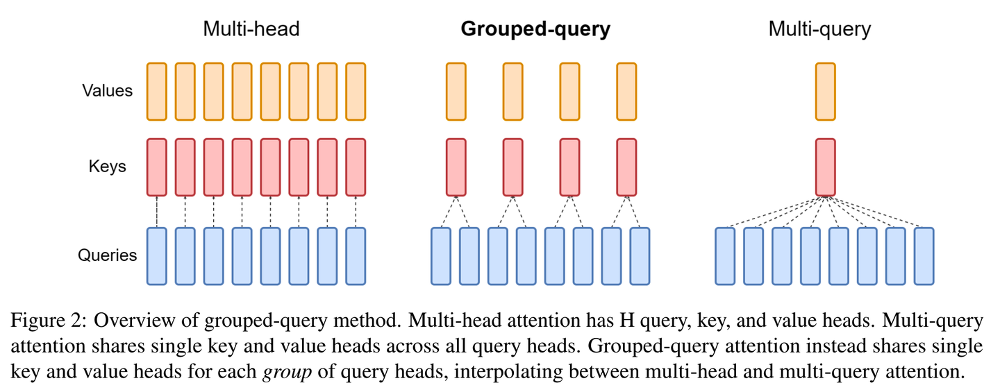
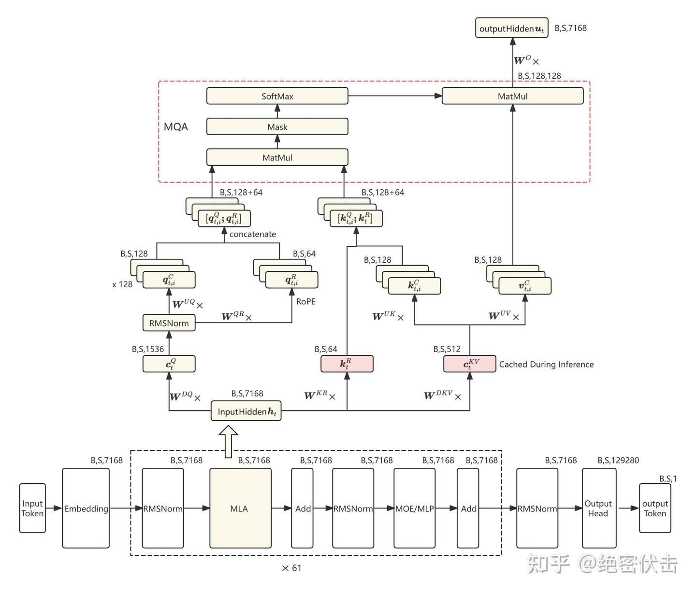

# 基础Attention 

> 输入为一个长为L的句子，然后经过一系列层，他变为n这个维度
>
> 具体流程详见[句子编解码笔记](../句子编解码/句子编解码.md)

Attention是根据输入的矩阵$input \in R^{L \times n}$去计算一个不同位置之间的关系得到一个，形成一个不同位置之间的关系的矩阵Attentionscore $\in R^{L \times L}$,  最后与当前 value 相乘得到加权后的上下文表示。
$$
Attention = softmax(\frac{Q*K^T}{\sqrt{d_k}})V , Attention \in R^{L \times n}, d_{k} 是 Key 的维度
$$

```python
class Attention:
    """
     初始化Attention层
        
     参数:
     - input_dim: 输入特征的维度 (n)
     - d_model: 模型隐藏层维度
     - d_k: Query和Key的维度
     - d_v: Value的维度
    """
  def __init__(self, input_dim, d_k, d_v):
    self.input_dim = input_dim
    self.d_k = d_k
    self.d_v = d_v
    self.w_q = nn.Linear(input_dim, d_k)
    self.w_k = nn.Linear(input_dim, d_k)
    self.w_v = nn.Linear(input_dim, d_v)
    
	def selfAttention(self, input):
    Q = self.w_q(input) # 维度变为b*L*d_k
    K = self.w_k(input) 
    V = self.w_v(input) 
    Attention_scores = F.softmax(torch.matmul(Q, k.transpose(1,2))/math.sqrt(self.d_k), dim = -1) # 维度b*L*L 这里去根据 , softmax可以帮助每行和为一
    selfAttention = torch.matmul(Attention_scores, V)# 维度变为b*L*d_k
    return selfAttention
  
  def crossAttention(self, query, key):
    Q = self.w_q(query)
    K = self.w_k(key) 
    V = self.w_v(key) # key 和 value来自编码器，Q来自解码器
    Attention_scores = F.softmax(torch.matmul(Q, k.transpose(1,2))/math.sqrt(self.d_k), dim = -1) # 维度b*L*L 这里去根据 , 与每一个key都有一个相关数，最后需要拼摊
    Attention = torch.matmul(Attention_scores, V)# 维度变为b*L*w
    return Attention
  
  def selfAttention_mask(self, input):
    
```

Q1:为什么 Self-Attention 中要除以 $\sqrt{d}$？

在 Transformer 的 Self-Attention 机制中，我们计算相似度权重时，会使用点积（Dot Product），并除以一个缩放因子 $\sqrt{d_k}$（其中 $d_k$ 是向量的维度）。

**核心原因：** 为了控制点积结果的方差，防止其随着维度 $d$ 的增大而变得过大，从而避免进入 Softmax 函数的梯度饱和区。

假设查询向量 $q$ 和键向量 $k$ 的两个分量 $q_i$ 和 $k_i$ 满足以下条件：
1.  **独立性**：$q_i$ 和 $k_i$ 相互独立。
2.  **零均值**：$\mathbb{E}[q_i] = \mathbb{E}[k_i] = 0$。
3.  **单位方差**：$\text{Var}(q_i) = \text{Var}(k_i) = 1$。

注意力权重（未归一化）定义为向量对应元素的乘积之和：
$$ \text{weights} = \sum_{i=1}^{d} (q_i \cdot k_i) $$

==推到过程==

由于 $q_i$ 和 $k_i$ 独立且均值为 0，计算 $q_i k_i$ 的方差：

$$
\begin{aligned}
\text{Var}(q_i k_i)
&= \mathbb{E}[(q_i k_i)^2] - (\mathbb{E}[q_i k_i])^2 \\
&= \mathbb{E}[q_i^2 k_i^2] - (\mathbb{E}[q_i]\mathbb{E}[k_i])^2 \\
&= \mathbb{E}[q_i^2] \cdot \mathbb{E}[k_i^2] - 0^2 \\
&= \text{Var}(q_i) \cdot \text{Var}(k_i) \\
&= 1 \cdot 1 = 1
\end{aligned}
$$

> **注**：因为均值为0，所以 $\mathbb{E}[q_i^2] = \text{Var}(q_i)$。

因为不同维度 $i \neq j$ 时的 $q_i k_i$ 与 $q_j k_j$ 相互独立，根据方差的可加性：

$$
\begin{aligned}
\text{Var}(\text{weights})
&= \text{Var}\left( \sum_{i=1}^{d} q_i k_i \right) \\
&= \sum_{i=1}^{d} \text{Var}(q_i k_i) \\
&= \sum_{i=1}^{d} 1 \\
&= d
\end{aligned}
$$

**结论**：点积结果的方差与向量维度 $d$ 成正比。

为了将方差标准化为 1，我们将权重除以 $\sqrt{d}$：

$$
\text{scaled\_weights} = \frac{\text{weights}}{\sqrt{d}}
$$

利用方差的性质 $\text{Var}(aX) = a^2 \text{Var}(X)$：

$$
\begin{aligned}
\text{Var}(\text{scaled\_weights})
&= \text{Var}\left( \frac{\text{weights}}{\sqrt{d}} \right) \\
&= \frac{1}{d} \cdot \text{Var}(\text{weights}) \\
&= \frac{1}{d} \cdot d \\
&= 1
\end{aligned}
$$

> Var(aX)=a^2Var(X)

Q2:w_q建议是扩维还是降维

# Dense Attention
## MHA（Multihead Attention）

也就是同时需要去计算多个注意力机制，去学习不同维度的信息，最后拼接在一块。

Notes:headi是先投影到低维子空间，再切头，而不是“一个头一个全维投影”

Q → [batch, seq_len, d_model]
→ 拆成 h 个 [batch, seq_len, d_k]
→ 并行计算 attention
→ concat → 再线性映射
$$
MultiHeadAttention(Q, K, V) = concat(head1,\dots,head_n)\\
head_i = Attention(W^Q·Q,W^K·K,W^V·V)
$$


多头注意力的好处：

简单来说就是（1）每个头确实学到东西有所不同，但大部分头之间的差异没有我们想的那么大（比如一个学句法，一个学词义这样明显的区分）（2）多个头的情况下，确实有少部分头可以比较好地捕捉到各种文本信息，而不会过分关注自身位置，一定程度缓解了上文提到的计算 之后对角线元素过大的问题。

目前可以看到的趋势是，模型越大（也就是hidden size越大），头数的增多越能带来平均效果上的收益（或者说允许注意力头增大而不影响子空间的学习能力）。

正如上述所描述一样，所以这里的d_k = d_model/h
>https://zhuanlan.zhihu.com/p/1959636888123049941

```python
class MHA:
    def __init__(self, input_dim, d_model, h):
        self.d_model = d_model
        self.h = h
        self.d_k = d_model // h
        self.w_q = nn.Linear(input_dim, d_model, bias=False)
        self.w_k = nn.Linear(input_dim, d_model, bias=False)
        self.w_v = nn.Linear(input_dim, d_model, bias=False)
        self.w_o = nn.Linear(d_model, d_model, bias=False)

    def calMHA(self, input):
        batch_size = input.size(0)

        Q = self.w_q(input)  # [B, L, h*d_k]
        K = self.w_k(input)
        V = self.w_v(input)

        # [B, h, L, d_k]
        Q = Q.view(batch_size, -1, self.h, self.d_k).transpose(1, 2)
        K = K.view(batch_size, -1, self.h, self.d_k).transpose(1, 2)
        V = V.view(batch_size, -1, self.h, self.d_k).transpose(1, 2)

        scores = torch.matmul(Q, K.transpose(-2, -1)) / math.sqrt(self.d_k)
        attn = F.softmax(scores, dim=-1)

        context = torch.matmul(attn, V)  # [B, h, L, d_k]
        context = context.transpose(1, 2).contiguous()  # [B, L, h, d_k]
        context = context.view(batch_size, -1, self.d_model)  # [B, L, d_model]
        context = self.w_o(context)
        return context

```

根据以上的学习，我们发现，在这个过程之中，会产生巨大的scores的中间量，所以需要存储中间量很复杂、

## MQA

MQA就是来减少缓存所需要的量的。

%%r:其中，只将Q进行切分，类似MHA中所做的，K和V直接从d_model降低到d_head = d_model // h%%

这会导致什么：1. Q和K乘积矩阵从$R \in [b, seq_l, h, h]$ 降低到 $R \in [b, seq_l, h, 1]$ 

但是，简单来说，就是MHA中，每个注意力头的score是不一样的，而MQA这里，每个注意力头的score是一样的，值是共享的。而其他步骤都和MHA一样。

```python
class MQA:
    """
    MQA: 所有 h 个 Q 头共享 1 组 K、V
    K, V 只有 1 个头 → w_k, w_v 输出维度 = d_k（不是 d_model）
    """
    def __init__(self, input_dim, d_model, h):
        self.d_model = d_model
        self.h = h
        self.d_k = d_model // h
        # Q: h 个头
        self.w_q = nn.Linear(input_dim, d_model, bias=False)
        # K, V: 只有 1 个头（维度 = d_k）
        self.w_k = nn.Linear(input_dim, self.d_k, bias=False)
        self.w_v = nn.Linear(input_dim, self.d_k, bias=False)
        self.w_o = nn.Linear(d_model, d_model, bias=False)

    def calMQA(self, input):
        batch_size = input.size(0)
        seq_len = input.size(1)

        Q = self.w_q(input)  # [B, L, h*d_k]
        K = self.w_k(input)  # [B, L, d_k]
        V = self.w_v(input)  # [B, L, d_k]

        # Q: [B, h, L, d_k]
        Q = Q.view(batch_size, seq_len, self.h, self.d_k).transpose(1, 2)

        # K, V: [B, L, d_k] → [B, 1, L, d_k] → 扩展为 [B, h, L, d_k]
        K = K.unsqueeze(1).expand(batch_size, self.h, seq_len, self.d_k)
        V = V.unsqueeze(1).expand(batch_size, self.h, seq_len, self.d_k)

        scores = torch.matmul(Q, K.transpose(-2, -1)) / math.sqrt(self.d_k)
        attn = F.softmax(scores, dim=-1)

        context = torch.matmul(attn, V)  # [B, h, L, d_k]
        context = context.transpose(1, 2).contiguous()  # [B, L, h, d_k]
        context = context.view(batch_size, seq_len, self.d_model)  # [B, L, d_model]
        context = self.w_o(context)
        return context

```


## GQA

GQA里， Q还是按原来MHA/MQA的做法不变。只使用一套共享的 K、V不是效果不好吗，那就还是多弄几套。但是不要太多，数量还是比 的头数少一些。这样相当于把 的多个头给分了group，同一个group内的 共享同一套 K、V，不同group的 所用的 K、V不同。



```python
class GQA:
    """
    GQA: h 个 Q 头分成 g 组，每组共享 1 组 K、V
    g = n_groups, 每组有 h//g 个 Q 头
    """
    def __init__(self, input_dim, d_model, h, n_groups):
        assert h % n_groups == 0
        self.d_model = d_model
        self.h = h
        self.g = n_groups
        self.d_k = d_model // h
        self.heads_per_group = h // n_groups

        # Q: h 个头
        self.w_q = nn.Linear(input_dim, d_model, bias=False)
        # K, V: g 个组（每组 1 个头）
        self.w_k = nn.Linear(input_dim, n_groups * self.d_k, bias=False)
        self.w_v = nn.Linear(input_dim, n_groups * self.d_k, bias=False)
        self.w_o = nn.Linear(d_model, d_model, bias=False)

    def calGQA(self, input):
        batch_size = input.size(0)
        seq_len = input.size(1)

        Q = self.w_q(input)  # [B, L, h*d_k]
        K = self.w_k(input)  # [B, L, g*d_k]
        V = self.w_v(input)  # [B, L, g*d_k]

        # Q: [B, h, L, d_k]
        Q = Q.view(batch_size, seq_len, self.h, self.d_k).transpose(1, 2)

        # K, V: [B, g, L, d_k]
        K = K.view(batch_size, seq_len, self.g, self.d_k).transpose(1, 2)
        V = V.view(batch_size, seq_len, self.g, self.d_k).transpose(1, 2)

        # 扩展: [B, g, L, d_k] → [B, h, L, d_k]
        K = K.repeat_interleave(self.heads_per_group, dim=1)
        V = V.repeat_interleave(self.heads_per_group, dim=1)

        scores = torch.matmul(Q, K.transpose(-2, -1)) / math.sqrt(self.d_k)
        attn = F.softmax(scores, dim=-1)

        context = torch.matmul(attn, V)  # [B, h, L, d_k]
        context = context.transpose(1, 2).contiguous()  # [B, L, h, d_k]
        context = context.view(batch_size, seq_len, self.d_model)  # [B, L, d_model]
        context = self.w_o(context)
        return context

```

## MLA

MLA 相较于 MHA 选择使用 hidden states 一个低秩纬度矩阵进行计算，MLA结构如下：



MLA 引入了低秩压缩：

- 将 Key/Value 投影到一个低维潜在向量 $c_t^{KV} \in \mathbb{R}^{d_c}\;(d_c \ll d_h n_h)$，并缓存它。
- 在需要时（训练时每步 or 推理时下一个 token）再通过上投影矩阵恢复近似的 $k_t, v_t$。

压缩：

$$
c_t^{KV} = W^{DKV} h_t, \quad c_t^Q = W^{DQ} h_t
$$

解压：

$$
\begin{aligned}
k_t^C &= W^{UK} c_t^{KV} \\
v_t^C &= W^{UV} c_t^{KV} \\
q_t^C &= W^{UQ} c_t^Q
\end{aligned}
$$

其中：

- $W^{DKV}, W^{DQ} \in \mathbb{R}^{d_c \times d}$：下投影矩阵（降维）
- $W^{UK}, W^{UV}, W^{UQ} \in \mathbb{R}^{d_h n_h \times d_c}$：上投影矩阵（恢复）

之后的注意力计算使用$q_t^C,k_t^C,v_t^C$

```python
class MLA(nn.Module):
    """
    Multi-head Latent Attention (MLA)
    
    Args:
        d_model: 模型维度
        n_heads: 注意力头数
        d_latent_kv: Key/Value 的潜在压缩维度 (通常 d_latent_kv << d_head * n_heads)
        d_head: 每个头的维度 (默认 d_model // n_heads)
        dropout: dropout 概率
    """
    def __init__(self, d_model, n_heads, d_latent_kv, d_head=None, dropout=0.1):
        super().__init__()
        self.d_model = d_model
        self.n_heads = n_heads
        self.d_head = d_head if d_head else d_model // n_heads
        self.d_latent_kv = d_latent_kv
        self.scale = 1.0 / math.sqrt(self.d_head)

        # ---- 压缩：将输入投影到潜在空间 ----
        # 将完整的 KV 维度压缩到 d_latent_kv
        self.kv_down_proj = nn.Linear(d_model, d_latent_kv * 2, bias=False)
        
        # ---- 上投影：从潜在空间恢复 ----
        self.k_up_proj = nn.Linear(d_latent_kv, n_heads * self.d_head, bias=False)
        self.v_up_proj = nn.Linear(d_latent_kv, n_heads * self.d_head, bias=False)

        # ---- Query 不做压缩（或也可压缩）----
        self.q_proj = nn.Linear(d_model, n_heads * self.d_head, bias=False)

        # ---- 输出投影 ----
        self.out_proj = nn.Linear(n_heads * self.d_head, d_model, bias=False)
        self.dropout = nn.Dropout(dropout)

    def forward(self, x, mask=None):
        """
        Args:
            x: (batch_size, seq_len, d_model)
            mask: (batch_size, seq_len, seq_len) 或 causal mask
        Returns:
            output: (batch_size, seq_len, d_model)
        """
        batch_size, seq_len, _ = x.shape

        # ---- Query ----
        q = self.q_proj(x)  # (B, L, n_heads * d_head)
        q = q.view(batch_size, seq_len, self.n_heads, self.d_head).transpose(1, 2)
        # q: (B, n_heads, L, d_head)

        # ---- KV 压缩到潜在空间 ----
        kv_compressed = self.kv_down_proj(x)  # (B, L, 2 * d_latent_kv)
        k_latent, v_latent = kv_compressed.chunk(2, dim=-1)
        # k_latent, v_latent: (B, L, d_latent_kv)

        # ---- 从潜在空间上投影恢复 K, V ----
        k = self.k_up_proj(k_latent)  # (B, L, n_heads * d_head)
        v = self.v_up_proj(v_latent)  # (B, L, n_heads * d_head)
        
        k = k.view(batch_size, seq_len, self.n_heads, self.d_head).transpose(1, 2)
        v = v.view(batch_size, seq_len, self.n_heads, self.d_head).transpose(1, 2)
        # k, v: (B, n_heads, L, d_head)

        # ---- 注意力计算 ----
        # attn_scores: (B, n_heads, L, L)
        attn_scores = torch.matmul(q, k.transpose(-2, -1)) * self.scale

        if mask is not None:
            attn_scores = attn_scores.masked_fill(mask == 0, float('-inf'))

        attn_weights = torch.softmax(attn_scores, dim=-1)
        attn_weights = self.dropout(attn_weights)

        # output: (B, n_heads, L, d_head)
        output = torch.matmul(attn_weights, v)

        # ---- 拼接多头 ----
        output = output.transpose(1, 2).contiguous()  # (B, L, n_heads, d_head)
        output = output.view(batch_size, seq_len, self.n_heads * self.d_head)

        # ---- 输出投影 ----
        output = self.out_proj(output)
        
        return output

```


# Sparse Attention（DSA）

核心思想：在注意力机制中引入稀疏性，不再让序列中每个唯一与所有位置都计算注意力
> 如何进行选择呢：1.固定模式，2.基于内容


```python
## DSA实现
import torch
import torch.nn as nn
import torch.nn.functional as F


class Indexer(torch.nn.Module):
    def __init__(self, args: ModelArgs):
        super().__init__()
        self.dim: int = args.dim
        self.n_heads: int = args.index_n_heads
        self.n_local_heads = args.index_n_heads // world_size
        self.head_dim: int = args.index_head_dim
        self.rope_head_dim: int = args.qk_rope_head_dim
        self.index_topk: int = args.index_topk
        self.q_lora_rank: int = args.q_lora_rank
        self.wq_b = Linear(self.q_lora_rank, self.n_heads * self.head_dim)
        self.wk = Linear(self.dim, self.head_dim)
        self.k_norm = LayerNorm(self.head_dim)
        self.weights_proj = Linear(self.dim, self.n_heads, dtype=torch.get_default_dtype())
        self.softmax_scale = self.head_dim ** -0.5
        self.scale_fmt = args.scale_fmt

        self.register_buffer("k_cache", torch.zeros(args.max_batch_size, args.max_seq_len, self.head_dim, dtype=torch.float8_e4m3fn), persistent=False)
        self.register_buffer("k_scale_cache", torch.zeros(args.max_batch_size, args.max_seq_len, self.head_dim // block_size, dtype=torch.float32), persistent=False)


    def forward(self, x: torch.Tensor, qr: torch.Tensor, start_pos: int, freqs_cis: torch.Tensor, mask: Optional[torch.Tensor]):
        bsz, seqlen, _ = x.size()
        end_pos = start_pos + seqlen
        q = self.wq_b(qr)
        q = rearrange(q, 'b s (h d) -> b s h d', d=self.head_dim)
        q_pe, q_nope = torch.split(q, [self.rope_head_dim, self.head_dim - self.rope_head_dim], dim=-1)
        q_pe = apply_rotary_emb(q_pe, freqs_cis)
        q = torch.cat([q_pe, q_nope], dim=-1)
        k = self.wk(x)
        k = self.k_norm(k)
        k_pe, k_nope = torch.split(k, [self.rope_head_dim, self.head_dim - self.rope_head_dim], dim=-1)
        k_pe = apply_rotary_emb(k_pe.unsqueeze(2), freqs_cis).squeeze(2)
        k = torch.cat([k_pe, k_nope], dim=-1)
        q = rotate_activation(q)
        k = rotate_activation(k)
        q_fp8, q_scale = act_quant(q, block_size, self.scale_fmt)
        k_fp8, k_scale = act_quant(k, block_size, self.scale_fmt)
        self.k_cache[:bsz, start_pos:end_pos] = k_fp8
        self.k_scale_cache[:bsz, start_pos:end_pos] = k_scale
        weights = self.weights_proj(x) * self.n_heads ** -0.5
        weights = weights.unsqueeze(-1) * q_scale * self.softmax_scale
        index_score = fp8_index(q_fp8.contiguous(), weights, self.k_cache[:bsz, :end_pos].contiguous(), self.k_scale_cache[:bsz, :end_pos].contiguous())
        if mask is not None:
            index_score += mask
        topk_indices = index_score.topk(min(self.index_topk, end_pos), dim=-1)[1]
        topk_indices_ = topk_indices.clone()
        dist.broadcast(topk_indices_, src=0)
        assert torch.all(topk_indices == topk_indices_), f"{topk_indices=} {topk_indices_=}"
        return topk_indices


class DSAAttention(nn.Module):
    """带 DSA 稀疏选择的多头自注意力（教学版，dense mask 模拟稀疏）"""
    def __init__(
        self,
        d_model: int,
        num_heads: int,
        topk: int = 2048,
        index_n_heads: int = 4,
        index_head_dim: int = 64,
        dropout: float = 0.0,
    ):
        super().__init__()
        assert d_model % num_heads == 0
        self.d_model = d_model
        self.num_heads = num_heads
        self.head_dim = d_model // num_heads
        self.topk = topk

        self.Wq = nn.Linear(d_model, d_model, bias=False)
        self.Wk = nn.Linear(d_model, d_model, bias=False)
        self.Wv = nn.Linear(d_model, d_model, bias=False)
        self.Wo = nn.Linear(d_model, d_model, bias=False)
        self.dropout = nn.Dropout(dropout)

        self.indexer = Indexer(d_model, index_n_heads, index_head_dim)

    def forward(self, x: torch.Tensor):
        b, T, _ = x.shape
        q = self.Wq(x)
        k = self.Wk(x)
        v = self.Wv(x)

        # 拆多头：b, heads, seq, dim
        q = q.view(b, T, self.num_heads, self.head_dim).transpose(1, 2)
        k = k.view(b, T, self.num_heads, self.head_dim).transpose(1, 2)
        v = v.view(b, T, self.num_heads, self.head_dim).transpose(1, 2)

        # 因果 mask：未来位置屏蔽
        pos_q = torch.arange(T, device=x.device)
        pos_k = torch.arange(T, device=x.device)
        causal_bool = pos_q.unsqueeze(-1) < pos_k.unsqueeze(0)
        causal_mask = torch.zeros(T, T, device=x.device, dtype=x.dtype)
        causal_mask.masked_fill_(causal_bool, float("-inf"))

        # DSA 选出 top-k token 下标
        topk_indices = self.indexer(x, x, self.topk, causal_mask=causal_mask)

        # 构造稀疏 mask：只保留选中位置
        sparse_mask = torch.full((b, T, T), float("-inf"), device=x.device, dtype=x.dtype)
        sparse_mask.scatter_(-1, topk_indices, 0.0)
        combined_mask = causal_mask.unsqueeze(0) + sparse_mask

        # 注意力打分
        attn_score = q @ k.transpose(-2, -1)
        attn_score = attn_score + combined_mask.unsqueeze(1)
        attn_weight = torch.softmax(attn_score / (self.head_dim ** 0.5), dim=-1)
        attn_weight = self.dropout(attn_weight)

        out = attn_weight @ v
        out = out.transpose(1, 2).contiguous().view(b, T, self.d_model)
        return self.Wo(out)


if __name__ == "__main__":
    dsa_attn = DSAAttention(d_model=512, num_heads=8, topk=128)
    x = torch.randn(2, 256, 512)
    y = dsa_attn(x)
    print("input shape:", x.shape)
    print("output shape:", y.shape)

```

# Recurrent/Linear Attention（KDA，DeltaNet，Mamba）


# Flash Attention

==背景==：传统需要计算 $$attention = softmax(QK^T)V$$, 这时候中间会产生一个巨大的矩阵，在SRAM中写不下，这时候会进行写入HBM的操作（很慢），也就引发带宽跟不上算力的问题，导致算力瓶颈

> HBM显存：容量大（几十GB），读写慢
>
> SRAM片上缓存：容量极大（几百kB），速度很快

==核心解决方法==

1. 分块（Tiling）：画整为零 （之前是一次性计算完全部庞大的矩阵存入内存）

   分块：Q按行切，K和V 按列切

   尺寸匹配：$$Q_{block}$$, $$K_{block}$$相乘获得的矩阵大小正好是SRAM的大小 好处是数据就在手边无需进行读写🤔

   ```
   while ：
   	for $$Q_{block}$$ in Q：
   		for $$K_{block}$$，$$V_{block}$$ in K，V：
   			 atten1 = softmax(Q_{block},K_{block}^T)V_{block}
   		
   ```

2. softmax -》safesoftmax -〉online softmax

   softmax
   $$
   softmax(x_i) = \frac{e^{x_{i}}}{\sum{e^{x_{i}}}}\ \ x_i\in x
   $$
   **弊端**：1. 你需要获取到全部矩阵，矩阵是没有办法存入到SRAM中的，所以需要进行HBM读写

   **手撕softmax函数**

   ```python
   X = torch.tensor([])
   def softmax(X):
     sum_x = x.exp().sum()
     result = X/sum_x
   	
   ```

   Safe softmax
   $$
   softmax(x_{block}) = \frac{e^{x_{block}}-m}{\sum{e^{x_{block}}-m}}\ \ x_{block}\in x,\ m是当前block的最大值
   $$


   safesoftmax与softmax的等价性	
$$
   \begin{aligned}
   \text{softmax}(x_{block}) 
   &= \frac{e^{x_{\text{block}} - m}}{\sum_{i=1}^{n} e^{x_{\text{block}} - m}} \\
   
   & = \frac{\frac{e^{x_{block}}}{e^m}}{\sum{\frac{e^{x_{block}}}{e^m}}}\\
   & = \frac{\frac{e^{x_{block}}}{e^m}}{\frac{\sum{e^{x_{block}}}}{e^m}}\\
   & =softmax(x_i)\\
   \text{其中 } & x_{\text{block}} \in x, \quad m = \max(x_{\text{block}})
   \end{aligned}
$$
   Online-safesoftmax

3. I/O感知内核

   计算attention方法 矩阵乘法-》缩法-〉mask —》softmax -〉矩阵乘法 统一合并为一个cuda kernel 中间产物无需读写，O(n^2)->O(n)

4. 重计算 Recomputational -》计算换带宽。训练过程中

   传统方法存下整个中间产物（Q，K，V）的庞大矩阵（forward正向计算过程中），再返回求积分的时候（back-propagation）继续使用，这里会进行大量的读写操作

   

   flash attention指存入m和d（🤔为什么只存这两个，为什么不一块去计算），到反向传播的时候重新来计算整个矩阵

==Flash Attention v1，v2，v3==

v1主要解决O(N^2)的显存站哟个问题，也就是说他提出了划分块进行计算的问题

v2强并行，提升了不同任务之间的分配逻辑

v3Hopper架构优化，利用H100上的TMA特性，可以一边算，一边把下一块数据读出/低精度加速（FP8）


#### 相关题目

- 介绍Flash Attention的原理和实现思路

- Flash Attention v2为什么外层对Q循环，Flash Decoding的combine kernel耗时占比大概是多少


# 编码技术
