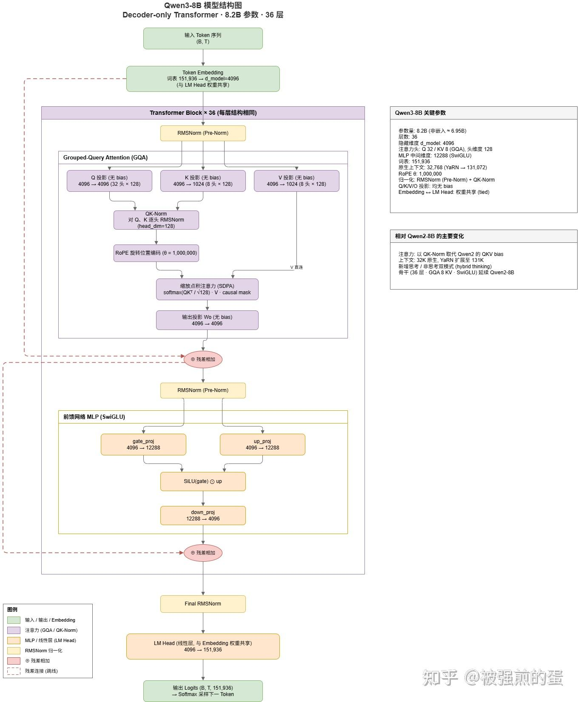

# Qwen3-8B
模型参数如下

字段｜值
----｜------
num_hidden_layers｜ 36
hidden_size｜4096
num_attention_heads	｜32
num_key_value_heads	｜8
head_dim｜128
intermediate_size｜12288
vocab_size｜151936
rope_theta｜1,000,000
max_position_embeddings｜40960
torch_dtype｜bfloat16

