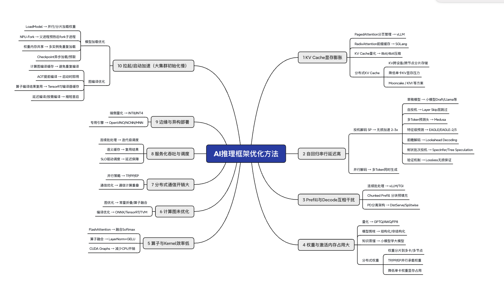

# 推理引擎

**推理引擎，顾名思义解决的是大模型的推理问题。**

给定一组到达时刻不同、长度各异的请求，把 GPU 的算力和显存压榨到极限，同时让每个用户感知到的延迟可控。

==相比训练，**推理更关注效率、延迟、吞吐量和部署可控性**，是生产环境中性能、成本和用户体验的关键驱动力。==

# 优化方法梳理

> 思维导图源文件：[AI推理框架优化方法.xmind](AI推理框架优化方法.xmind)

# 总览

| 问题 | 优化策略 | 影响指标 |
| --- | --- | --- |
| **集群初始化慢** | 模型加载优化，图编译优化| 拉起耗时 |
| **自回归串行延迟高** | 分为p侧优化和d侧优化和合部优化| TTFT / TPOT |
| **显存不足** | 显存优化与offload：PagedAttention、前缀缓存、量化（GPTQ/AWQ/FP8）、剪枝、蒸馏、offload | 显存水位 / batch 上限 （tps）/ TTFT/TPOT |
| **卡间通信开销大** | 集群通信优化：通信计算重叠、分层通信、DeepEP、跨节点 KV 传输（控制面 + 数据面） | 通信关键路径占比 |
| **并行负载不均** | 负载均衡：PP stage 切分、EPLB 冗余专家、DP 请求派发 | 卡间均衡度 / 长尾延迟 |
| **请求编排与配比不当** | 服务吞吐与调度：连续批处理、Chunked Prefill、PD 分离、SLO 驱动调度 | QPS / P99 / SLO 达标率 |
| **PD 资源画像不一致** | 异构部署：prefill/decode 两侧采用不同型号的卡混部 | 每 token 成本 / 毛利 |

# 逐项展开

## 0・拉起/启动加速（大集群初始化慢）

- **模型加载优化**
  - LoadModel → 并行/分片加载权重
  - NPU-Fork → 父进程预热后 fork 子进程
  - 权重内存共享 → 多实例免重复加载
  - Checkpoint 异步加载/预取

  📖 笔记：[集群初始化/模型加载优化](./优化方向/0%20集群初始化慢/模型加载优化.md)

- **图编译优化**
  - 编译缓存、AOT 提前编译、算子编译结果复用（TensorRT/编译器缓存）、延迟编译/按需编译
    📖 笔记：[集群初始化/模型加载优化](./优化方向/0%20集群初始化慢/图编译优化.md)

## 1・自回归串行延迟高 — 投机解码（无损加速 2~3x）

- 草稿模型（Draft/Llama 小模型）、自投机（Layer Skip）、多 Token 预测头（Medusa）
- 特征级预测（EAGLE-1/2/3）、前瞻解码（Lookahead）、树状批次投机（SpecInfer）
- 验证机制保证无损（Lossless）；另一路：并行解码多 Token 同时生成

📖 笔记：[优化方向/自回归串行延迟高](./优化方向/自回归串行延迟高/投机解码.md)

## 2・算子与 Kernel 效率低

- FlashAttention（融合 Softmax）、算子融合（LayerNorm+GELU）、CUDA Graphs 消减 CPU 开销

📖 笔记：[优化方向/算子与计算图低效](优化方向/算子与计算图低效/计算图优化.md)

## 3・显存不足

### 3.1 kv cache 显存多

- PagedAttention 分页管理（vLLM）
- RadixAttention 前缀缓存（SGLang）
- KV Cache 量化（8bit/4bit）
- 分布式 KV Cache：跨设备/跨节点分片，Mooncake / KIVI 等方案

📖 笔记：[KV Cache](../../1%20底层/1.4%20KV%20Cache/KV%20Cache.md) · [VLLM/KV Cache管理](推理引擎/VLLM/KV%20Cache管理.md)

### 3.2・权重与激活内存占用大

- 量化（GPTQ/AWQ/FP8）、剪枝（结构化/非结构化）、知识蒸馏
- 分布式权重：TP/PP/EP 并行承载、分片到多卡/多节点

📖 笔记：[优化方向/显存不足/显存优化与offload](优化方向/显存不足/显存优化与offload.md)

## 5・卡间通信开销大

- 并行策略选择（TP/PP/EP）、通信计算重叠

📖 笔记：[优化方向/卡间通信开销大/集群通信优化](优化方向/卡间通信开销大/集群通信优化.md) · [5P 推理](推理并行/5p推理.md)（并行原理）

## 6・并行负载不均

- 并行策略导致
📖 笔记：[优化方向/并行负载不均](优化方向/并行负载不均) ·

## 3・请求编排与配比不当
- 请求粒度：Chunked Prefill 分块预填充、连续批处理（vLLM/TGI）
- PD 分离架构：DistServe / Splitwise
- PD 比例

📖 笔记：[优化方向/请求编排与配比不当/pd](优化方向/请求编排与配比不当/pd.md)

## 6・服务化吞吐与调度

- 连续批处理（迭代级调度）、语义缓存复用结果、SLO 驱动调度（延迟保障）
- 并行维度负载均衡：EPLB / stage 切分 / DP 请求派发

📖 笔记：[优化方向/服务吞吐与调度/pd](优化方向/服务吞吐与调度/pd.md) · [优化方向/负载均衡](优化方向/负载均衡/负载均衡.md)

### 9・边缘与异构部署

- 端侧量化（INT8/INT4）、专用引擎（OpenVINO/NCNN/MNN）

📖 笔记：⬜ 待补充

## 引擎横评

- [推理架构（TGI / vLLM / TensorRT-LLM / SGLang / llama.cpp / DeepSpeed 六引擎总览）](推理引擎/推理架构.md)

