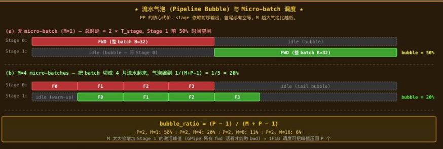
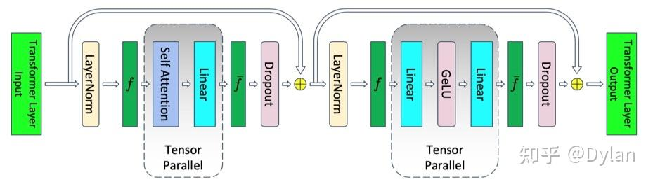
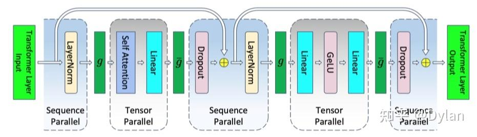

# 5p推理

https://zhuanlan.zhihu.com/p/2035106376138085860

本文覆盖推理场景的 7 种并行策略：**TP、PP、DP、EP、DP Attention、SP、CP。**

> 本文讲"模型怎么切"；切分后数据在卡间怎么传输（集合通信原语、NVLink/IB 机制）见 [集群通信](../../1%20底层/1.2%20集群通信/集群通信.md)，其中附有各策略通信算子对照表。

按切分维度分为四组：

- **Weight（参数维度）**：TP、EP
- **Batch（样本维度）**：DP、DP Attention
- **Sequence / Context（序列维度）**：SP、CP
- **Layer（深度维度）**：PP


平行主要涉及三个方面的东西：放得下，跑的快，通信不达瓶颈

一批seq的维度是[B,S,hidden],所以需要短句子长句子去padding成同一长度

# TP（Tensor parallel）

**简单记为：** 两种切法相间——QKV / up / gate **按列切**（砍输出维，各卡算各的，无通信）；wo / down_proj **按行切**（砍输入维 dim=-1，输出是部分和，出口 AllReduce 合并）

张量并行是指对模型==内部的参数矩阵==切分，然后利用分块矩阵乘进行计算得到正确结果，由于参数矩阵是以tensor表示，故叫张量并行

**好处**

- 权重、KV cache、TP 区域激活按 N 等分，线性降显存
- Prefill 阶段计算量也按 N 等分，扩算力

**代价**

- 每层 2 次 AllReduce（Attention 后 + MLP 后），对带宽极敏感
- 必须在 [NVLink](https://zhida.zhihu.com/search?content_id=274277475&content_type=Article&match_order=1&q=NVLink&zhida_source=entity) 域内（跨 IB 效率个位数），通常 **TP ≤ 8**
- Decode S=1 时 AllReduce 延迟主导
- TP > num_kv_heads 时要复制 KV head（KV cache 放大）

**为什么正好是每层 2 次 AllReduce？**

1. 行并行 GEMM 的输出是**部分和**，必须归约一次才能继续参与后续计算
2. 每层恰好有**两个行并行出口**：Attention 的 `wo` 之后、MLP 的 `down_proj` 之后（QKV / up / gate 都是列并行，不产生任何通信）
3. 两个出口之间隔着 `residual + LN`：**LayerNorm 与残差必须作用于完整激活**，部分和直接喂进去结果就错了 → 两次 AR 无法合并成一次，也不能攒到层尾
4. "2 次/层"是列并行免通信 + 行并行出口各归约一次的必然结果。想减通信只能换结构或做融合：SP 把 AR 拆成 AG+RS（见下文 §SP）、引擎层把 AR+RMSNorm 融合（vLLM cutlass allreduce-rmsnorm）、decode 小消息用 one-shot allreduce

> 模型配置 h = 8192 n_heads = 64 d_head = 128 S = 2000 B = 32 TP = 4 单机四卡
>
> **计算一次 TP 的全流程：**
>
> 1. 输入 x [32, 2000, 8192]，每卡全量副本
> 2. **QKV 列并行（无通信）**：wq ∈ [8192, 8192] 按输出维切成 [8192, 2048]，每卡算 64/4 = 16 个头 → 单卡产出 q [32, 16, 2000, 128]
> 3. **本地 Attention**：各卡只在自家 16 个头上做 softmax·v，产出 [32, 16, 2000, 128]
> 4. **wo 行并行**：w_o ∈ [8192, 8192] 按输入维（dim=-1）切成 [2048, 8192]，输入正是自家 16 个头拼接出的 [32, 2000, 2048]，产出**部分和** [32, 2000, 8192]
> 5. **① AllReduce**：4 卡逐元素求和 → 完整 attention 输出 [32, 2000, 8192]，随后 residual + LN（每卡各自做，结果一致）
> 6. **MLP gate/up 列并行（无通信）**：按输出维切 → GeLU / gating 本地完成
> 7. **down_proj 行并行**：又得到部分和 [32, 2000, 8192]
> 8. **② AllReduce** → residual + LN → 完整输出 [32, 2000, 8192] 进入下一层
>
> 每层结论：2 次 AR。decode 时 S=1，单次消息 = 1 × 8192 × 2B ≈ 16 KB，延迟主导（对应上面"decode AllReduce 延迟主导"）。

==使用行列切分相结合的好处==

- 若相邻两个 Linear **都按列切**：每个出口都要先拼再通信；**都按行切**：每个入口都要先 AllGather 输入
- `列 → 行` 相邻放置时，列切的产物（按输出维竖切的激活）正好就是行切想要的输入切片，**两个 GEMM 之间零通信**，通信只落在块出口
- 这就是 Megatron 行列相间能把通信压到"每块 1 次 AR"的原因

# PP（Pipline parallel）

**简单记为：** 按layer把模型切到多张卡，每一层layer不切 --- **只在 stage 边界 P2P 传一次激活**——用最小通信换”装下超大模型”。

**好处**

- **通信量最小**：只在 stage 边界 P2P 传一次激活，远小于 TP 的每层 AllReduce
- **跨机最友好**：不依赖 NVLink，普通 IB / 以太网也能跑
- 把参数切到”深度”维度，单机装不下的超大模型首选维度
- Prefill 阶段 micro-batch 可流水填满，吞吐近 N×

**代价**

- **流水气泡**：stage 串行依赖，首尾必有空等;靠 micro-batch 摊平，但 decode 难做大 M
- **Decode 单请求延迟 = P 段之和**：token 必须串行穿过所有 stage，PP 不降低延迟
- **stage 切分需手工平衡**：每段 FLOPs / 参数量接近才能填满流水
- 显存各 stage 不均衡（embedding、lm_head 偏重，KV cache 按层摊到各 stage）

> 前n层layer在gpu0上，后m层在gpu1上
>
> 所以传输只涉及gpu0之后的的outputs维度，每一个gpu需要存储他负责layers部分的全部参数，全部流程：
>
> - GPU0跑16层MHA+1层mlp
> -  GPU1在跑16层MHA+1层MLP
>
> 引发问题，gpu1在接到gpu0之前时需要完全等待，GPU 处于 idle意味着服务器利用率低 / 吞吐下降，micro-batch可以解决这类问题
>
> $bubble\_{ratio} = \frac{PP - 1}{M + P - 1}$, where PP is Pipeline parallel, M is micro-batch
>
> 
>
> 


# DP（data parallel）

**简单记为：** 解决数据量过大，针对于一个机器多张卡的概念，切分是针对dim = 0，针对batch进行切分，因此每一张卡需要全部模型，卡间不需要相互通信

**好处**

- 实现最简（SPMD，不切权重），跨机友好
- 吞吐 ×N 线性扩展，单请求延迟 = 单卡延迟
- 是 DP Attention 的”宿主维度”：`dp_size > 1` 才能开 DP Attention（见 §5）

**代价**

- 每卡放完整权重 + 完整 KV cache，**N 卡总显存 = N × 单卡**
- 单卡装不下模型时 DP 不能单独用，必须叠 TP/PP/EP
- 请求绑 rank，热/冷不均无法动态再平衡

**两种dp**
- pytorch dp： 单进程多线程，主卡做scatter/gather，存在GIL和负载不均
- pytorch ddp：多进程，每个进程一个GPU，使用NCCL在后端做all-reduce

>[!NOTE]
> - 为什么ddp比dp快？
dp需要主卡先将数据scatter到其他卡上，然后等forward完成，再reduce所有梯度，计算loss，主卡又算又传
除此之外，虽然gpu kernel不受限于GIL锁的影响，但是cpu调度会受到GIL的影响
> - ddp梯度同步发生在backward哪一步？
每一层计算完梯度，会将当前梯度存入bucket，当bucket满的时候，就会触发梯度传输，这样可以再算的时候传输，完成时延掩盖


# EP（Expert Parallel）

**简单记为：**：MoE 模型里把 256 个 expert 分到 N 卡，每 MoE 层 dispatch + combine 两次 A2A。

**好处**

- MoE 专家本来互相独立，按专家切零耦合
- 支撑巨大总参数量（DeepSeek-V3 671B 总 / 37B 激活）
- 通信规整（双向 A2A），可用 DeepEP 等 backend 深度优化

**代价**

- 每 MoE 层 2 次 A2A，跨机带宽敏感
- 负载不均：热门 expert 堆压某 rank → 需 capacity factor / EPLB
- 小 batch 低效：每卡进 expert 的 token 太少 GEMM 跑不满
- 只适用 MoE 模型

> 上面三条代价（A2A 栅栏、负载不均、显存预算）的解法：**EPLB 冗余专家、capacity factor、DP 调度均衡**——详见 [负载均衡](../优化方向/负载均衡/负载均衡.md)

# MP（Model Parallel，模型并行）

**简单记为：** 与 DP（切数据）相对，凡是把**模型本身**拆到多卡都叫 MP。它是总称，实际由两种切法组合实现：

| 子策略     | 切法                                       | 粒度            | 通信                    | 部署位置             |
| ---------- | ------------------------------------------ | --------------- | ----------------------- | -------------------- |
| TP（层内） | 每一层的权重矩阵按输出维/输入维切到多卡    | 细（单层内）    | 每层 2 次 AllReduce     | NVLink 域内（TP≤8）  |
| PP（层间） | 整座模型按层切成 stage，每 stage 整层      | 粗（stage 级）  | stage 边界 P2P Send/Recv | 跨节点友好           |

**好处**

- 解决"单卡装不下"：权重、激活、KV cache 被均摊，显存随卡数下降
- 参数不重复存储（对比 DP 每卡全量副本），N 卡显存利用率高
- 各维度正交可叠加：TP × PP × EP 组合出多维模型并行

**代价**

- 引入卡间通信：DP 稳态近零通信，MP 每一步都要动数据
- 都不降低单请求延迟：TP 的出口 AllReduce 在 decode 关键路径，PP 的延迟 = P 段串行之和
- 配置复杂：TP/PP/DP 组合要权衡通信、气泡与显存，混合并行度调参是重点

> stage 切分不均、气泡、EP 热门专家、DP 冷热 rank 的均衡解法见 [负载均衡](../优化方向/负载均衡/负载均衡.md)

MP 与 TP / PP 的对比表：

| 特性             | **模型并行（Model Parallelism）**                            | **张量并行（Tensor Parallelism）**                           | **流水线并行（Pipeline Parallelism）**                       |
| ---------------- | ------------------------------------------------------------ | ------------------------------------------------------------ | ------------------------------------------------------------ |
| **核心思想**     | 将**模型的不同组件**拆分到不同设备上，每个设备负责一部分网络层的计算 | 将**单个层的张量计算**拆分到不同设备上，按维度切分权重与激活值，并行完成矩阵运算 | 将**模型按层切分成多个阶段（Stage）**，每个设备负责一个阶段，按流水线方式顺序执行计算与通信 |
| **拆分粒度**     | 粗粒度：层间拆分（如 Transformer 的 Encoder Layer 1-10 在卡 0，11-20 在卡 1） | 细粒度：层内拆分（如一个 Linear 层的权重矩阵按列切分，分散到多卡） | 粗粒度：阶段拆分（如将 100 层 Transformer 拆成 10 个 Stage，每卡负责 10 层） |
| **计算逻辑**     | 单卡完成自身负责层的完整计算，层间传递激活值                 | 多卡协同完成同一层的计算，通过 All-Reduce 等操作聚合梯度 / 输出 | 多卡按流水线时序执行，前一卡计算完的激活值传递给后一卡，同时自身开始下一个 batch 的计算 |
| **通信开销**     | 低 - 中：仅在层间传递激活值 / 梯度，通信量与激活值大小正相关 | 高：层内计算需要频繁的 All-Reduce 通信，通信量与张量维度正相关 | 中 - 高：阶段间传递激活值，且存在 "气泡"（流水线空闲时间），通信量与阶段数正相关 |
| **显存优化核心** | 单卡仅存储**部分模型层**的权重、激活值、梯度                 | 单卡仅存储**单个层的部分权重**、激活值切片，大幅降低单卡显存占用 | 单卡仅存储**单个阶段**的模型权重、激活值，适合超深模型       |
| **典型适用场景** | 模型结构不规整（如含分支的 CNN）、中小规模模型跨卡拆分       | Transformer 类规整模型的训练 / 推理，单节点多卡场景          | 超大规模模型（万亿参数）的训练，多节点多卡场景               |

# SP（Sequence Parallelism，序列并行）

**简单总结：**针对长序列，也就是dim=1进行切分，相较于TP，额外多一次通信

**好处**

- 消除 TP 区域外（LN / Residual）的激活冗余 → 单层峰值激活 ÷ N
- 训练首选（激活要保留给反向，省的就是显存上限）
- 不引入新通信域（AG / RS 仍用 TP group）

**代价**

- 必须依附 TP，不是独立维度
- 通信次数 +1：`1× AR` 变 `1× AG + 1× RS`，字节数相同但 collective 多 1 次
- **推理收益小**（激活用完即丢），训练价值大

标准 Transformer 一层天然分两区：

```text
x → [LayerNorm] → [QKV → Attention → Out Proj] → [Residual] → 输出
        SP               TP                        SP
      只能按 S 切       可以按 H 切                只能按 S 切
```

**标准 TP 的漏洞**： 区每卡存完整 `[S, H]`，N 卡冗余 N 份。

**SP 的方案**：用和 §4.2 **同一个恒等式** `AllReduce ≡ ReduceScatter + AllGather`，但换一种拆法——把 TP 的每次 AR 拆成 **AG（TP 入口）+ RS（TP 出口）**，中间夹 TP 区，两侧留 SP 区只存 `[S/4, H]` 小激活：

```text
  [S/4, H] → LayerNorm → ⭐AG↗ →   [S, H]
  [S, H] → QKV → Attn → OutProj → partial [S, H] → ⭐RS↘ →   [S/4, H] → Res
  
  
  
  
  
  
```


如下针对一个transformer block 制作TP和TP+SP的流程对比





