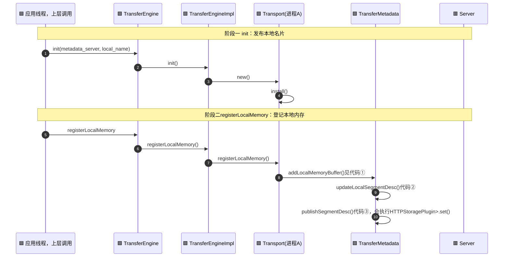

Mooncake是月之暗面与清华大学联合开源的以KVCache为中心的分离式发模型推理架构实现

# 总览
Mooncake Store最重要的架构是：master只管理元数据，数据传输尽量绕过Master


## 组件总览
```text
┌──────────────────────────────────────────────────────────────────────────┐
│                         上层框架 / 生态集成                                 │
│  SGLang · vLLM · LMDeploy · TensorRT-LLM · LMCache · verl · 自研推理服务    │
└───────────────┬──────────────────────────────────┬───────────────────────┘
                │ KV / 权重 / 隐藏态读写             │ 分布式集合通信 / EP
                ▼                                  ▼
┌───────────────────────────────┐   ┌──────────────────────────────────────┐
│        Mooncake Store         │   │  Mooncake EP / PG / Backend          │
│  分布式 KV Cache / 权重对象存储  │   │  MoE dispatch/combine, ProcessGroup   │
│  master(元数据/租约/淘汰)         │   │  all_gather/all_reduce, 故障感知       │
│  client(put/get/batch/副本)      │   │  弹性 rank 恢复                        │
│  storage(DRAM/SSD/NVMe/HF3FS)   │   └──────────────────┬───────────────────┘
└───────────────┬───────────────┘                      │
                │ 批量 TransferRequest                  │
                ▼                                       ▼
┌──────────────────────────────────────────────────────────────────────────┐
│                     Mooncake Transfer Engine (TE)                        │
│  统一批量传输接口: allocateBatchID / submitTransfer / getTransferStatus    │
│  拓扑感知选路 · 多网卡聚合 · 失败重试 · 事件驱动完成通知                       │
│      ┌──────────────────── MultiTransport（路由层）────────────────────┐    │
│      │ 按 segment.protocol / target buffer 选择具体 Transport          │    │
│      └───┬───────┬───────┬───────┬───────┬───────┬───────┬────────────┘    │
│          ▼       ▼       ▼       ▼       ▼       ▼       ▼                 │
│        RDMA    TCP     EFA     CXI    NVMe-oF  NVLink   HIP/CXL/Ascend...   │
│          └───────┴───────┴───────┴───────┴───────┴───────┘                 │
└───────────────┬──────────────────────────────────────────────────────────┘
                │
      ┌─────────┴─────────┐
      ▼                   ▼
┌──────────────┐   ┌──────────────────────────────────────────────────────┐
│ 元数据服务     │   │ 硬件/网络层                                            │
│ etcd / HTTP / │   │ RDMA(RoCE/IB) · TCP · NVLink · CXL · NVMe SSD · HBM    │
│ P2P handshake │   │ CUDA / HIP / MUSA / MACA / MLU / Ascend NPU / XPU       │
└──────────────┘   └──────────────────────────────────────────────────────┘

旁路组件:
  mooncake-conductor  —— 控制面/调度编排
  mooncake-reshard    —— 权重/缓存重分片
  mooncake-rl         —— RL rollout/训练数据搬运示例
  mooncake-p2p-store  —— 基于 TE 的 P2P store demo
  mooncake-store-rs   —— Store 的 Rust 实现
  TENT                —— TE 的新一代运行时，独立 transport 体系

```


## 仓库目录
```text
Mooncake/
├── mooncake-transfer-engine/        # 核心：高性能数据传输引擎
│   ├── include/
│   │   ├── transport/transport.h    # Transport 抽象基类（Batch/Slice/Request）
│   │   ├── transport/<proto>_transport/   # 各后端头文件（tcp/rdma/efa/...）
│   │   ├── transfer_engine.h        # 对外 C++ API
│   │   ├── multi_transport.h        # 多后端路由层
│   │   └── transfer_metadata.h      # Segment/Buffer 元数据
│   ├── src/
│   │   ├── transfer_engine.cpp           # 公共 API 实现（含 TENT/legacy 分派）
│   │   ├── transfer_engine_impl.cpp      # init、拓扑发现、自动安装 transport
│   │   ├── multi_transport.cpp           # installTransport/selectTransport/submit
│   │   ├── transfer_metadata.cpp         # etcd/HTTP/P2P 元数据
│   │   ├── topology.cpp                  # 网卡/NUMA 拓扑
│   │   └── transport/
│   │       ├── transport.cpp             # BatchID/BatchDesc 基类实现
│   │       ├── tcp_transport/            # TCP 后端
│   │       ├── rdma_transport/           # RDMA 后端
│   │       ├── efa_transport/ cxi_transport/ nvmeof_transport/
│   │       ├── nvlink_transport/ intranode_nvlink_transport/
│   │       ├── hip/musa/maca/ascend/...  # 异构加速器路径
│   │       └── shm_transport/            # 同机共享内存
│   ├── tent/                        # 新一代传输运行时（独立 transport: tcp/rdma/
│   │                                #   io_uring/gds/mnnvl/xpu/tpu/...）
│   ├── allocator/                   # 共享内存/NPU/NVLink 分配器
│   ├── benchmark/ example/ tests/
│   └── rust/                        # TE 的 Rust 绑定
│
├── mooncake-store/                  # 分布式 KV Cache / 权重存储引擎
│   ├── include/
│   │   ├── master_service.h         # master：元数据、租约、淘汰
│   │   ├── client_service.h         # client：put/get/batch/副本
│   │   ├── transfer_task.h          # Store→TE 的批量传输封装
│   │   ├── storage_backend.h        # 存储后端抽象
│   │   └── allocator.h segment.h replica.h eviction/ ...
│   └── src/                         # 上述实现 + rpc + storage/local_ssd/...
│
├── mooncake-store-rs/               # Store 的 Rust 版本（crates/）
├── mooncake-ep/                     # MoE Expert Parallel（dispatch/combine）
├── mooncake-pg/                     # PyTorch ProcessGroup 后端 / 集合通信
├── mooncake-conductor/              # 控制面编排（go/rust/cpp）
├── mooncake-reshard/                # 缓存/权重重分片（python）
├── mooncake-rl/                     # RL 数据搬运示例
├── mooncake-p2p-store/              # 基于 TE 的 P2P store 示例
├── mooncake-integration/            # Python/C++ 绑定（store/transfer_engine/conductor）
├── mooncake-wheel/ python/          # pip 打包与 Python 包
├── mooncake-common/                 # 公共工具/基础类型
├── docs/ image/ scripts/ benchmarks/ docker/ monitoring/
└── CMakeLists.txt  dependencies.sh  README.md

```

## Mooncake 如何支持不同后端传输
概览：RDMA / TCP / EFA / CXI / NVMe-oF / NVLink / HIP / MUSA / MACA / Ascend / CXL / Barex / SHM / UB / FlagCX / Sunrise 等，均以同一 Transport 接口接入，由 MultiTransport 按 segment 协议和目标地址选择。

核心是 Transport 抽象基类 + MultiTransport 路由 + 插件式 install。

### 统一抽象
mooncake-transfer-engine/include/transport/transport.h 定义所有后端必须实现的接口：

```cpp
class Transport {
  virtual BatchID allocateBatchID(size_t batch_size);
  virtual Status submitTransfer(BatchID, const std::vector<TransferRequest>&) = 0;
  virtual Status submitTransferTask(const std::vector<TransferTask*>&);
  virtual Status getTransferStatus(BatchID, size_t task_id, TransferStatus&) = 0;
  virtual int install(...);                    // 注册 segment、起监听/握手
  virtual int registerLocalMemory(...) = 0;
  virtual const char* getName() const = 0;
};
```

统一数据模型：BatchDesc → TransferTask → Slice，请求只描述"读写 + 源地址 + target_id + 目标偏移 + 长度"，由具体 Transport 决定如何落地。

### 路由层 MultiTransport
multi_transport.cpp:1109 installTransport(proto, topo) 用 if/else + 编译宏 把协议名映射成具体对象（rdma/tcp/efa/cxi/nvmeof/nvlink/hip/shm/ascend/...），再 install() 注册到 transport_map_。

投递时 multi_transport.cpp:1283 selectTransports → :1315 selectTransport：

```text
读取 target SegmentDesc.protocol
  ├─ 单一协议 "tcp"     → transport_map_["tcp"]
  ├─ 多协议 "rdma,tcp"  → 按目标地址命中的 buffer + 优先级选择
  │                        (hylink > hip/musa/shm > cxl > rdma > tcp)
  ├─ 本机 IPC 不可达时，hip/musa/shm 自动降级到 rdma/tcp
  └─ "rdma" 未装但有 rdma_twosided → 路由到 twosided
```

同一批请求可以按 target_id 被拆到不同 Transport，再按 Transport 分组调用 submitTransferTask（multi_transport.cpp:642 起）。

### 后端的三种启用方式
自动发现：transfer_engine_impl.cpp:230 起，init() 根据编译宏、拓扑发现的 HCA 列表、环境变量决定装哪个：
- 有 HCA → rdma（或 autoDiscoverTransport() / barex）
- 无 HCA → tcp
- Ascend → ascend；NVLink/MUSA 单独分支；EFA 优先等

显式安装：TransferEngine::installTransport("tcp", args) → TransferEngineImpl::installTransport → MultiTransport::installTransport，并把已注册的本地内存重新注册到新 transport。

环境变量开关：MC_FORCE_TCP（只装 TCP）、MC_FORCE_SHM、MC_FORCE_HCA、MC_FORCE_MNNVL、MC_ENABLE_HYLINK 等。

### 两套运行时
Classic TE：multi_transport.cpp 的 transport 插件体系（本文主要讲这套）。
TENT：tent/src/transport/{tcp,rdma,gds,io_uring,mnnvl,xpu,tpu,...}，在 TransferEngine 层通过 use_tent_ 分派（transfer_engine.cpp:1010），自带调度与 transport_hint。

# Transfer Engine
Mooncake Transfer Engine 是一个围绕 Segment 和 BatchTransfer 两个核心抽象设计的高性能，零拷贝数据传输库。

Segment 代表一段可被远程读写的连续地址空间，既可以是 DRAM 或 VRAM 提供的非持久化存储 RAM Segment，也可以是 NVMeof 提供的持久化存储 NVMeof Segment。

BatchTransfer 封装了操作请求，具体负责将一个 Segment 中非连续的一组数据空间的数据和另外一组 Segment 的对应空间进行数据同步，支持 Read/Write 两种方向，因此类似一个异步且更灵活的的 AllScatter/AllGather。

## 抽象概念
- Segment：一段可被远程访问的地址空间，通常对应一个进程或设备暴露出的内存范围
- Buffer: Segment里注册的连续内存区域，带地址、长度和传输所需的key/设备信息
- BatchTransfer：一次提交多个非连续读写项的异步批量操作，减少逐项PRC和系统调用开销


## 最小生命周期
```cpp
// 1. 初始化：连元数据服务，发布本地 segment，自动安装 transport
engine.init(metadata_server, local_server_name);        // 返回 int，0 成功

// 2. 注册本地内存：让本机可被读写、并允许对端通过 rkey/地址访问
engine.registerLocalMemory(buf, len, "cpu:0" /*或 cuda:0*/,
                           /*remote_accessible=*/true);

// 3. 打开对端 segment：解析对端描述、交换 buffer 信息，返回 SegmentID/Handle
auto target_id = engine.openSegment(remote_name);

// 4. 分配 batch：n = 这次要投递的请求条数
auto batch = engine.allocateBatchID(n);
if (batch == INVALID_BATCH_ID) { /* 失败处理 */ }

// 5. 投递：异步，立即返回；requests 只在提交期间需要有效
std::vector<TransferRequest> reqs = { /* READ/WRITE items */ };
auto st = engine.submitTransfer(batch, reqs);
if (!st.ok()) { engine.freeBatchID(batch); /* 失败处理 */ }

// 6. 轮询：按 task 逐个查，直到全部 terminal
for (size_t i = 0; i < n; ++i) {
    TransferStatus s;
    do {
        engine.getTransferStatus(batch, i, s);   // 没有 timeout 参数
    } while (s.s == TransferStatus::WAITING /* 自己加 deadline */);
}

// 7. 释放 batch（必须在全部完成后）
engine.freeBatchID(batch);

// 8. 收尾
engine.closeSegment(target_id);
engine.unregisterLocalMemory(buf);
engine.freeEngine();
```

==时序图==

```cpp
//代码①
int TransferMetadata::addLocalMemoryBuffer(const BufferDesc &buffer_desc,
                                           bool update_metadata) {
    {
        RWSpinlock::WriteGuard guard(segment_lock_);
        auto &segment_desc = segment_id_to_desc_map_[LOCAL_SEGMENT_ID];
        auto new_segment_desc = std::make_shared<SegmentDesc>(*segment_desc);
        new_segment_desc->buffers.push_back(buffer_desc);
        new_segment_desc->rebuildBufferRangeIndex();
        segment_desc = new_segment_desc;
    }
    if (update_metadata) return updateLocalSegmentDesc();
    return 0;
}

//代码②
int TransferMetadata::updateLocalSegmentDesc(uint64_t segment_id) {
    uint64_t published_version = 0;
    std::string segment_name;
    {
        RWSpinlock::ReadGuard guard(segment_lock_);
        auto it = segment_id_to_desc_map_.find(segment_id);
        if (it == segment_id_to_desc_map_.end() || !it->second) {
            LOG(ERROR) << "Segment descriptor " << segment_id << " not found";
            return ERR_METADATA;
        }
        segment_name = it->second->name;
    }
    ....
    // 防止多进程互相覆盖
    Json::Value existing;
    if (storage_plugin_->get(getFullMetadataKey(segment_name), existing) &&
        existing.isMember("metadata_version") &&
        existing["metadata_version"].isUInt64()) {
        published_version = existing["metadata_version"].asUInt64();
    }

    std::shared_ptr<SegmentDesc> desc;
    {
        RWSpinlock::WriteGuard guard(segment_lock_);
        auto it = segment_id_to_desc_map_.find(segment_id);
        if (it == segment_id_to_desc_map_.end() || !it->second) {
            LOG(ERROR) << "Segment descriptor " << segment_id << " not found";
            return ERR_METADATA;
        }
        desc = std::make_shared<SegmentDesc>(*it->second);
        desc->metadata_version = nextWallTimeMetadataVersion(
            it->second->metadata_version, published_version);
        it->second = desc;
    }
    // 发布数据到远端存储
    return this->publishSegmentDesc(desc->name, *desc);
}

//代码③
int TransferMetadata::publishSegmentDesc(const std::string &segment_name, const SegmentDesc &desc) {
    ...
    Json::Value segmentJSON;
    // 将数据序列化为json
    // {
    // "name": "local_segment_0",
    // "protocol": "tcp",
    // "metadata_version": 42,
    // "buffers": [
    // {"addr": "0x7f000000", "length": 4096, "perm": "RW"},
    // {"addr": "0x7f001000", "length": 8192, "perm": "RO"}
    // ]
    // }
    int ret = encodeSegmentDesc(desc, segmentJSON);
    if (ret) {
        return ret;
    }
    //❗️storage_plugin_->set()这里会写入元数据后端
    if (!storage_plugin_->set(getFullMetadataKey(segment_name), segmentJSON)) {
        LOG(ERROR) << "Failed to register segment descriptor, name "
                   << desc.name << " protocol " << desc.protocol;
        return ERR_METADATA;
    }
    return 0;
}

//plugin走http为例子
bool set(const std::string &key, const Json::Value &value) override {
        CURL *h = tl_easy();
        curl_easy_reset(h);

        Json::StreamWriterBuilder wb;
        wb["indentation"] = "";
        const std::string payload = Json::writeString(wb, value);

        std::string readBody;
        char errbuf[CURL_ERROR_SIZE] = {0};

        curl_easy_setopt(h, CURLOPT_TIMEOUT_MS, 3000L);
        curl_easy_setopt(h, CURLOPT_CONNECTTIMEOUT_MS, 1500L);

        const std::string url = encodeUrl(key);
        curl_easy_setopt(h, CURLOPT_URL, url.c_str());
        curl_easy_setopt(h, CURLOPT_CUSTOMREQUEST, "PUT");
        curl_easy_setopt(h, CURLOPT_POSTFIELDS, payload.c_str());
        curl_easy_setopt(h, CURLOPT_POSTFIELDSIZE, payload.size());

        curl_easy_setopt(h, CURLOPT_WRITEFUNCTION, writeCallback);
        curl_easy_setopt(h, CURLOPT_WRITEDATA, &readBody);
        curl_easy_setopt(h, CURLOPT_ERRORBUFFER, errbuf);

        struct curl_slist *headers = nullptr;
        headers = curl_slist_append(headers, "Content-Type: application/json");
        // The JSON body is already buffered; send it without waiting for 100
        // Continue.
        auto *without_expect = curl_slist_append(headers, "Expect:");
        if (!without_expect) {
            curl_slist_free_all(headers);
            return false;
        }
        headers = appendAuthHeader(without_expect);
        curl_easy_setopt(h, CURLOPT_HTTPHEADER, headers);

        CURLcode rc = curl_easy_perform(h);
        curl_slist_free_all(headers);

        if (rc != CURLE_OK) {
            LOG(ERROR) << "PUT " << url << " curl: " << curl_easy_strerror(rc)
                       << " err: " << errbuf;
            return false;
        }

        long code = 0;
        curl_easy_getinfo(h, CURLINFO_RESPONSE_CODE, &code);
        if (!is_200(code)) {
            LOG(ERROR) << "PUT " << url << " http=" << code
                       << " body: " << readBody;
            return false;
        }
        return true;
    }
```

## 元数据准备

## 完成协议
```text
transport.h:184 Slice、:548 TransferTask、:631 BatchDesc：
BatchDesc（一个 batch）
 └─ task_list: vector<TransferTask>      // 一条逻辑请求一个 task
      └─ slice_list: vector<Slice*>       // task 可拆成多个 slice
           Slice.status: PENDING/POSTED/SUCCESS/FAILED/TIMEOUT
- Slice 是最小完成单元：一次 READ/WRITE，markSuccess/markFailed 都作用在它上面。
- Task 聚合 slice：slice_count / success_slice_count / failed_slice_count / transferred_bytes。
- Batch 聚合 task：finished_task_count / has_failure / is_finished，以及事件通知状态。
```


# 一个例子：讲解TCP传输这一条路
以 SubmitTransfer（Store 的 batch read/write）为例，从请求进入一直到数据落到对端内存。


## 调用总览
```text
应用 (Store Client / Python)
  │  std::vector<TransferRequest>
  ▼
TransferSubmitter::submitTransfer           mooncake-store/src/transfer_task.cpp:1759
  │  allocateBatchID(n)                      transfer_task.cpp:1812
  │  engine_.submitTransfer(batch_id, reqs)  transfer_task.cpp:1816
  ▼
TransferEngine::submitTransfer              transfer_engine.cpp:1010
  │  (use_tent_ ? TENT : legacy)
  ▼
TransferEngineImpl::submitTransfer          include/transfer_engine_impl.h:145
  ▼
MultiTransport::submitTransfer              multi_transport.cpp:610
  │  selectTransports → 每组 Transport*
  │  构造 BatchDesc.task_list（TransferTask）
  │  transport->submitTransferTask(tasks)
  ▼
TcpTransport::submitTransferTask            tcp_transport.cpp:587
  │  prepareTransfer → Slice
  │  startTransfer(slice)
  ▼
enqueuePooledTransfer / lane pump           tcp_transport_lane_impl.h:544
  ▼
ClientSession::initiate                     tcp_transport_session_impl.h:515
  │  SessionHeader{size, addr, opcode|v2}
  ▼  ── TCP wire ──
ServerSession::readHeader                   tcp_transport_session_impl.h:219
  ├─ WRITE: readBody → 写目标内存
  └─ READ : writeBody → 从目标内存读
Completion: Slice::markSuccess → task/slice 计数
  ▲
调用方轮询 getTransferStatus               tcp_transport.cpp:531
  / multi_transport.cpp:824
  ▼
freeBatchID 释放 BatchDesc

```

### 分配 Batch
transfer_engine.cpp:300 → MultiTransport::allocateBatchID：

new BatchDesc，id 直接存放指针，batch_size 为后续 task_list 预留。
BatchID 是"指针即句柄"，toBatchDesc() 直接 reinterpret_cast，热路径零查找。

### 提交一批请求
MultiTransport::submitTransfer (multi_transport.cpp:610) 做几件事：

校验 batch 容量、event-enabled 语义。
selectTransports(entries, transports)：逐条按 target_id 解析目标 SegmentDesc 的 protocol，得到每条请求对应的 Transport*。
为每条请求在 batch_desc.task_list 里 emplace_back() 一个 TransferTask，写入 batch_id / request / transport_；若 transport 支持无轮询完成计数则 unsealTaskSubmission。
按 Transport* 分组，调用各自的 submitTransferTask(task_list)。
返回后再 sealTaskSubmission（完成计数/事件通知的封口）。
关键点：一批请求在 MultiTransport 就被"按后端分组"，TCP 只收到路由到它的那部分。

### TCP 侧：把请求变成 Slice
TcpTransport::submitTransferTask (tcp_transport.cpp:587)：

普通请求：startTransfer(prepareTransfer(task, *task->request))。
带 task_group_id 的请求：按组收集 Slice，走 startTransferSequence，保证组内顺序提交（scatter 语义）。
prepareTransfer (tcp_transport.cpp:628)：

slice->source_addr = request.source;
slice->length      = request.length;
slice->opcode      = request.opcode;
slice->tcp.dest_addr = request.target_offset;  // 对端逻辑地址
slice->task        = task;
slice->target_id   = request.target_id;
slice->status      = PENDING;
task->slice_count++;

每多一个请求，task->slice_count 加一；完成判定依赖 success_slice_count + failed_slice_count == slice_count。

### 建立/复用连接并发送
TcpTransport::startTransfer (tcp_transport.cpp:735)：

metadata_->getSegmentDescByID(target_id) 拿对端描述，取 tcp_data_host / tcp_data_port。
计算 use_v2 = desc->tcp_proto_version >= 2。
构造 TcpWorkItem{slice, use_v2, continuation}。
若启用连接池（默认，MC_TCP_ENABLE_CONNECTION_POOL 可关）或 scatter 要求复用：
enqueuePooledTransfer(peer, key, work)（tcp_transport_lane_impl.h:544）把任务放入该 peer 的 固定 lane 队列：
PeerConnectionGroup：每 peer 一个队列，默认 lanes_per_peer=4，有队列/字节数上限与准入超时（MC_TCP_LANES_PER_PEER、MC_TCP_MAX_QUEUED_*、MC_TCP_ADMISSION_TIMEOUT_MS）。
runGroupPump (:773) 在 asio executor 上调度：排队 → 准入 → 找到空闲 lane → startLaneSession (:1221)。
lane 状态机：DISCONNECTED → CONNECTING → IDLE → BUSY → COMPLETING。
禁用连接池时：getConnection() 同步建连，startTransferWithSocket() 直接发起。

### 客户端会话（ClientSession）
startTransferWithSocket (tcp_transport.cpp:803) 创建 ClientSession 并 initiate(source, dest_addr, length, opcode)（tcp_transport_session_impl.h:515）：

header_.addr   = htole64(dest_addr);
header_.size   = htole64(size);
header_.opcode = opcode | (v2 ? kOpcodeV2Flag : 0);
writeHeader();

writeHeader (tcp_transport_session_impl.h:689) 后按方向分流：

WRITE:  v2 → readWriteAck() 与 writeBody() 并发；v1 → writeBody()
READ :  v2 → readReadStatus()（先读 8B 状态帧）→ readBody()
        v1 → readBody()

分块：getChunkSize() 默认 64KB（MC_TCP_SLICE_SIZE 可调），每个 chunk 一次 async_write/async_read。

超时：MC_TCP_PROGRESS_TIMEOUT_SEC（滑动活跃超时，默认 30s）、MC_TCP_STATUS_TIMEOUT_SEC（状态帧超时）。

GPU 内存：客户端用 TcpStagingBuffer 做 device↔host staging（cudaMemcpy/ACL 等）。

线上协议（极简）
[ SessionHeader: uint64 size | uint64 addr | uint8 opcode ]  （小端）
opcode: 0=READ, 1=WRITE；最高位 bit7 = v2 标志
READ  : 客户端发头 → 服务端回数据（v2 先回 8B 状态帧）
WRITE : 客户端发头 + 数据 → 服务端写入目标内存（v2 写完后回 8B ACK）
v2 状态帧: 高 32 位 magic "MCTV"，低 32 位 0=OK / 1=地址拒绝

3.6 服务端会话（ServerSession）
ServerSession (tcp_transport_session_impl.h:171) 是常驻连接上的循环：

readHeader() (:219)：读头，取 opcode/addr/size；validate_addr_ 校验目标地址必在已注册 buffer 内（validateTcpAddress），否则 v2 回 kStatusAddrRejected 并断连。
WRITE → readBody() (:339)：按 chunk async_read 到 addr+offset；GPU 目标先读 staging 再 cudaMemcpy H2D；全部收完后 v2 才 sendStatus(kStatusOk)，然后 start() 等下一个请求。
READ → writeBody() (:270)：v2 先发状态帧，再按 chunk async_write；GPU 源先 D2H。
每个 chunk 完成回调递归调用同类函数，直到 total_transferred_bytes_ == size。
注意：TCP 的 ServerSession 必须在 TcpTransport::install (tcp_transport.cpp:405) 里通过 allocateLocalSegmentID 发布 tcp_data_host/port/proto_version，并启动 TcpContext 的 acceptor（io_pool_ 的 shard 0 doAccept）。

3.7 完成与状态轮询
传输终态由 ClientSession::finalize (tcp_transport_session_impl.h:665) 回调到 lane，最终 Slice::markSuccess() / markFailed()（transport.h）。
markSuccess 对 task->transferred_bytes 和 success_slice_count 做原子累加，并更新 completion_state；当 success+failed == slice_count 且已 seal 时 finishIfComplete() 置完成、递增 BatchDesc::finished_task_count，事件型 batch 还会唤醒 eventfd。
调用方 getTransferStatus：
MultiTransport::getTransferStatus (multi_transport.cpp:824) 委托 task.transport_->getTransferStatus；
TcpTransport::getTransferStatus (tcp_transport.cpp:531) 读三个原子计数：全到齐 → COMPLETED/FAILED，否则 WAITING；超时判定在 MultiTransport 层用 slice_timeout 做。
同步等待时由 TransferFuture（mooncake-store/src/transfer_task.cpp）轮询/等待完成；全部结束后 freeBatchID 释放 BatchDesc 与切片缓存。


