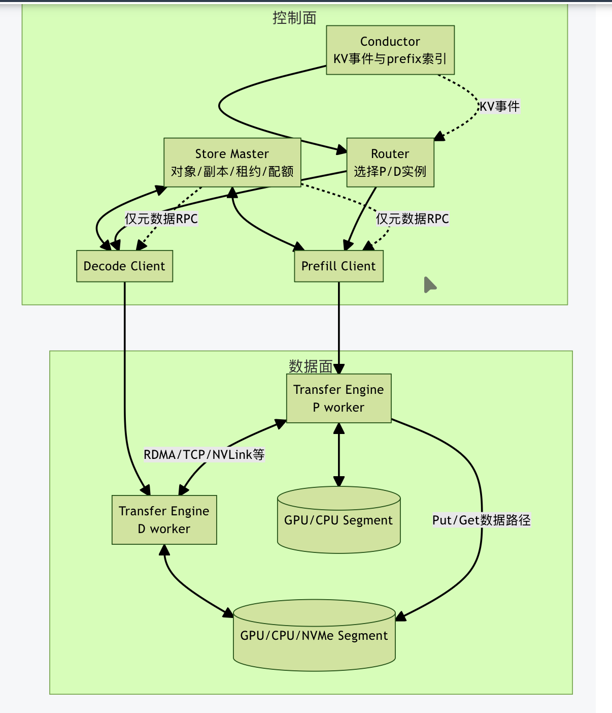

Mooncake是月之暗面与清华大学联合开源的以KVCache为中心的分离式发模型推理架构实现

# 总览
## 组件总览

## 仓库目录

#总体架构
Mooncake Store最重要的架构是：master只管理元数据，数据传输尽量绕过Master



# Transfer Engine
## 抽象概念
- Segment：一段可被远程访问的地址空间，通常对应一个进程或设备暴露出的内存范围
- Buffer: Segment里注册的连续内存区域，带地址、长度和传输所需的key/设备信息
- BatchTransfer：一次提交多个非连续读写项的异步批量操作，减少逐项PRC和系统调用开销

## 最小生命周期
```python
engine.init(metadata_config);
auto local = engine.registerlocalMemory(per,length,location)
auto remote = engine.openSegment(remote_name)
auto batch = engine.allocateBatchID();
engine.submitTransfer(batch,{read_or_write_items})
engine.getTransferStatus(batch, timeout_ms)
engine.freeBatchID(batch)
```

## 初始化

多协议路由
Transfermanager有多个推理协议的后端：

## DataTransfer


