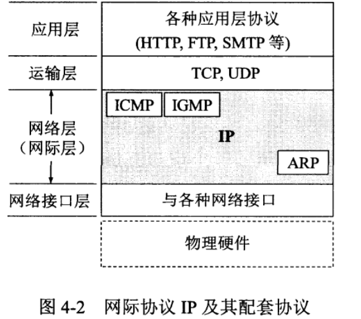
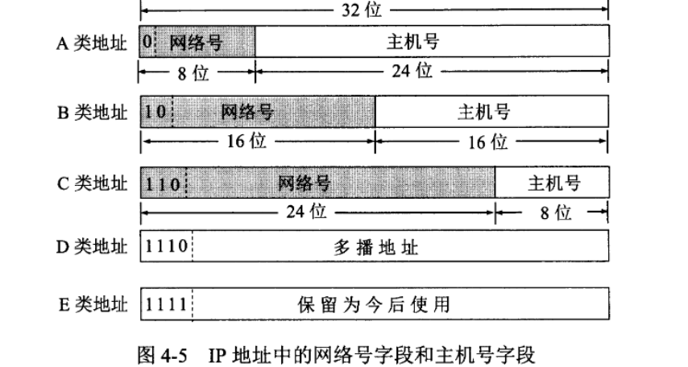
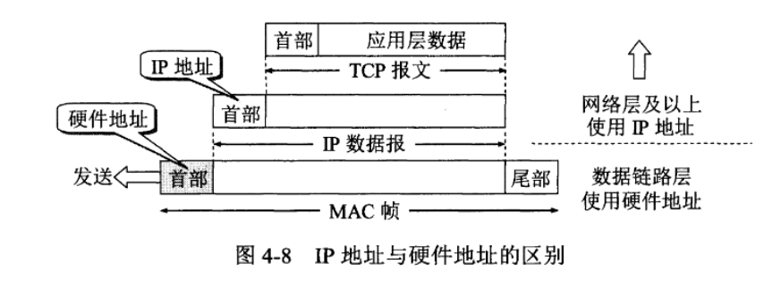
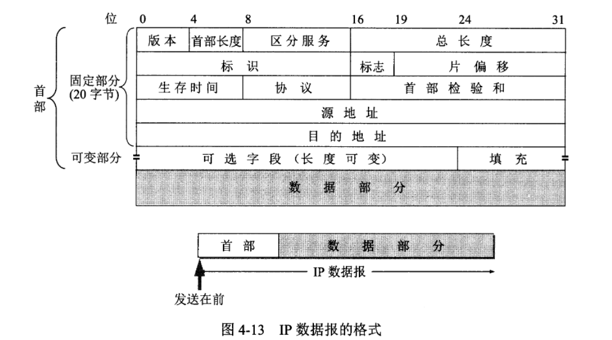
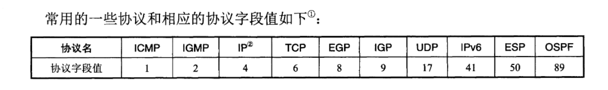
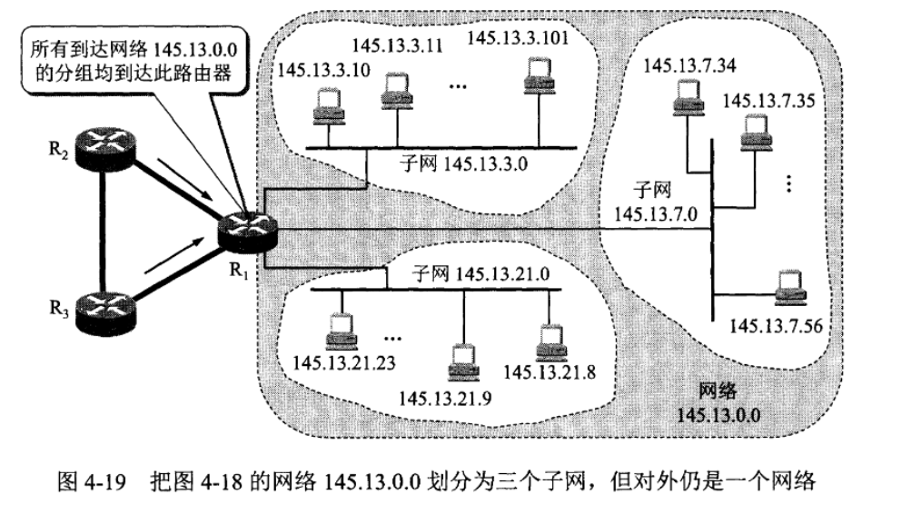
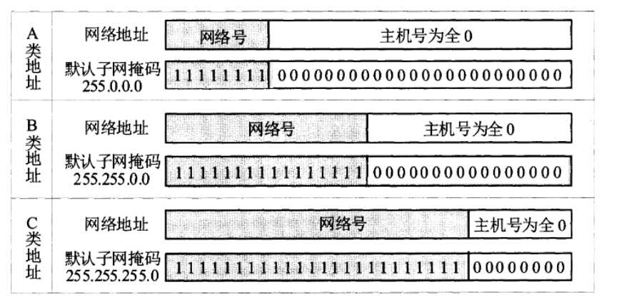
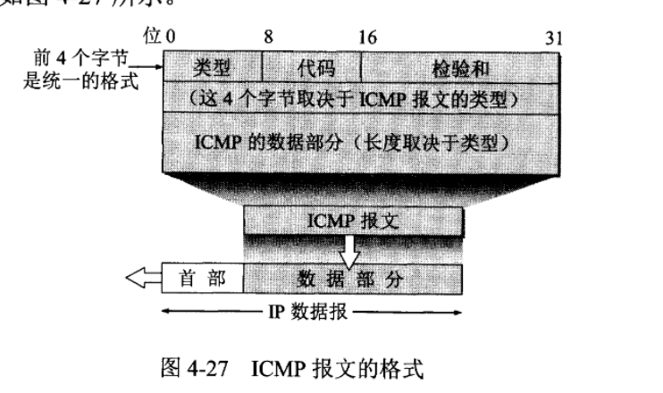
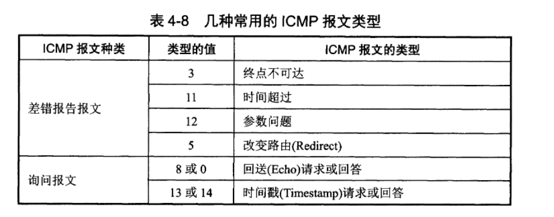

# 计算机网络的性能
1. 速率 （bit/s）
2. 带宽
3. 吞吐量
4. 时延：
　　- 发送时延
　　- 传播时延
   - 处理时延
   - 排队时延
5. 时延带宽积
6. 往返时间RTT
7. 利用率

# 3 数据链路层
数据链路主要有三个基本问题：
- 封装成帧：在一段数据的前后分别添加首部和尾部，这样就构成一个帧（通过这两个标记，识别开始和结束），因此一个帧的长度 = 数据 + 首标记 + 尾标记，但是每一种链路层协议规定了可以传输的数据部分的长度上限（MTU，maximum transfer unit）
- 透明传输
- 差错检测

# 4 网络层
网络层向上只提供简单灵活的，无连接的，尽最大努力交付的数据报服务，**不提供服务质量的承诺**

## 4.2 网络协议ip
ip协议的最大作用是使这些性能各异的网络在网络层上看起来好像是一个统一的网络
与ip协议配套使用的有以下三个协议：1. 地址解析协议ARP（Address Resolution Protocol），网络控制报文协议ICMP（Internet Control Message Protocol），网络组管理协议IGMP（Internet Group Management Protocol）

如图{@fig:ip_protocol}所示，ARP位于最下面，因为IP经常要使用这个协议。ICMP和IGMP需要使用IP协议，所以绘制在更上一层。
> 由于网际协议IP是用来是互连起来的许多计算机网络能够进行通信的，因此TCP/IP体系中的网络层常常被称为网际层（internet layer）/ IP层

{#fig:ip_protocol}


### 4.2.1 虚拟互联网络
将网络互相连接起来要使用一些中间设备：
- 物理层 ： 转发器（repeater）
- 数据链路层 ： 网桥/桥接器（bridge）
- 网络层 ： 路由器（router）
- 网络层以上：网关（gateway）

### 4.2.2 分类的ip地址
ip地址就是给每一个主机的每一个接口分配**独一无二的32位标识符**。ip地址现在由华联网名字和数字分配机构ICANN进行分配
```text
ip地址 ：：={<网络号>，<主机号>}
```
如图{@fig:ip_address}所示,
{#fig:ip_address}
- A,B,C 都是单播，一对一通信
- A,B,C 的网络号段分别为1个，2个和3个字节长，前面有*类别位（0/10/110）*
- A,B,C 的主机好短分别为3个2个和一个字长
- D（前4位1110）用于多播（1对多）
- E（前4位1111）保留为以后用
> 由于32位2进制很难读，因此没8位拆一个空格（10000000 00001011 00000011 00011111111）
> ，或者一个.(点分十进制) （128.11.3.31）

---
以A类网络地址为例子：
1.他可表示的网络号是126个（2^7-2）：原因是 00000000 表示this ； 01111111保留作为本地软件还回测试本主机的进程之间的通信之用
2. 他可表示的主机号：2^24-2 ,同理，全0表示该ip地址是本主机所连接到的单个网络地址，全1表示all，表示该网络号段的所有主机

IP地址总结：
1. a.IP地址管理机构只分配网络号，而主机号由该网络号的单位自行分配， b. 路由器仅根据**目的主机**所连接的网络号来转发分组，大幅减少路由表所占的存储空间以及查找路由表的时间
2. ip地址标志一台主机和一条链路的接口，当一台主机同时连接到两个网络上时，该主机就必须同时具有两个响应的IP地址，这种主机称为多归属主机（notes，同一个主机号，但是网络号不同）；因此路由器智商应当有两个不同的IP地址，对外和对内
3. 用转发器和网桥连接起来的若干个局域网仍为一个网络，因为他们具有同样的网络号
4. 网络号之间相互平等


### 4.2.3 IP地址与硬件地址
如{@fig:IP_hardware_address}所示，物理地址数据链路层和物理层使用的地址，而IP地址是网络层和以上各层使用的地址，是一种逻辑地址（ip地址本质是通过软件实现的）
{#fig:IP_hardware_address}

### 4.2.4 地址解析协议ARP
ARP的作用是从IP地址中解析处数据链路层使用的硬件地址；通过读取主机中ARP高速缓存（ARP Cache）中存放的IP地址到硬件地址的映射表（这个表会动态更新）
- 如果ARP cache中查到，直接向这个硬件地址发送MAC帧
- 如果查不到，就像局域网中发送请求（我是谁，我想要知道谁的硬件地址），符合这个特征的会进行回应，发送一个目的地址，之后正常传输

### 4.2.5 IP数据报的格式
{@fig:ip_data}是IP数据报的完整格式，一个ip数据报由首部和数据两部分组成，首部的前一部分是固定长度（20个字节，必须携带），后面部分可以选择携带
{#fig:ip_data}
1. **首部**（20个字节 = 160位，1字节=8位，）：
　　- 版本：4位，ip协议版本，通信双方版本必须一致(ipv4/ipv6)
　　- 首部长度：4位
　　- 区分服务 8位
　　- 总长度 16位,单位为字节，因此最大长度为2^16-1 = 65535字节
> 数据链路层规定了MTU（最大传输单元），因此总长度这里不能超过MTU

　　- 标识：16位，用于处理当数据报超过MTU进行分片时候，到达对方可以进行拼接
　　- 标志：3位（2位有意义），最低位位MF（More Fragment），表示后面还有分片，最后一个分片会设置MF=0；中间一位极为DF（Dont Fragment），不能分片，DF=0，才会进行分片
　　- 片偏移：13位
　　- 生存时间（TTL，Time To Live）： 8位，TTL是一个递减的过程，=0时候，就丢弃这个数据报
　　- 协议 ：8位，使目的主机的IP层知道应将数据部分上交给哪个协议进行处理


　　- 首部校验和：16位，只教研数据报的首部，不包括数据部分
　　- 源地址 32位（{网络号，主机号}）
　　- 目标地址 32位（{网络号，主机号}）

### 4.2.6 IP层转发分组的流程

## 4.3 划分子网和构造网
### 4.3.1 划分子网
**问题：**1. IP地址空间的利用率很低（申请了A类的 根本没有那么多主机）2.每一个物理网分配一个网络号会导致路由表变得太大，网络性能变差 3. 两级IP地址不够灵活

因此，通过划分子网（子网寻址，子网路由选择），通过增加一个子网号段，是二级IP地址变为三级IP地址
```text
IP ：：= {<网络号>，<子网号>，<主机号>}
```
{#fig:subnet}


### 4.3.2 子网掩码
如{@fig:subnet}所示，当数据报倒带路由器R1之后，我如何转发到子网
通过利用子网掩码和某个子网的IP地址逐位相与（AND），就能得出IP地址的网络地址来，子网掩码如{@fig:subnet_mask}所示

{#fig:subnet_mask}

## 4.4 网络控制报文协议ICMP
ICMP允许主机或路由器报告差错情况和提供异常情况的报告，ICMP报文是装在IP数据报中


ICMP报文有两类，如{@fig:ICMP_message_category}：
- ICMP差错报告报文
- ICMP询问报文
{#fig:ICMP_message_category}

> ICMP的一个重要应用就是分组网间探测PING（Packet InterNet Groper），用来测试两台主机之间的连通性，**PING是应用层直接使用网络层ICMP的一个例子**

## 4.5 互联网的路由选择协议
### 4.5.1 基本概念
**理想的路由算法：** 1. 算法必须是正确和完整的 2. 算法是简洁的 3. 算法能适应通信量和网络拓扑的变化 4.算法应具有稳定性 5. 算法应是公平的 6.算法应是最佳的

互联网的路由选择主要是自适应的/动态的，分布式路由选择协议；可以将互联网划分为许多小的自治系统AS（autonokous system），互联网将

