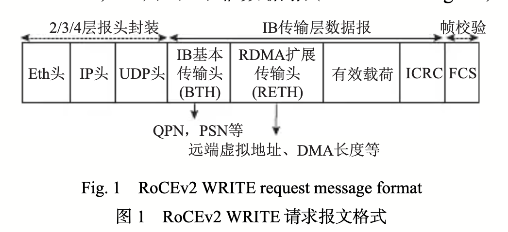

> [1]黄曼蒂,李韬,杨惠,等.以太网RDMA网卡综述[J].计算机研究与发展,2025,62(5):1262-1289.

1. 背景：以太网的传输速率 突破400Gps，朝着800Gps，1.6Tps发展，cpu的处理速度无法跟上
2. 定义：RDMA （remote direct memory access）远程直接内存访问，不需要CPU参与的情况下直接读下远端内存，实现高带宽低延迟的数据传输
3. 实现方式：IB（InfiniBand），RoCE（RDMA over coveraged Ethernet）和 iWarp
  - IB 性能最好，但自定义了全链路层的整套规范，需要专用网卡和交换机支持，不兼容以太网且价格昂贵
  - ROCE v1 将 IB 的链路层替换为以太网协议，ROCE v2 在 v1 基础上进一步将网络层替换为UDP/IP协议，== 允许使用标准以太网交换机进行跨网路由，只需要额外增设一个专用网卡支持 ==
  - iWarp 同样兼容以太网，但需将整个TCP/IP协议栈卸载到硬件
综上所述，网卡的实现是ROCE中最重要和最复杂的部分 1.需要完成协议卸载，可靠传输，拥塞控制）；同时交换机上需要具备简单的功能（优先级流控，显示拥塞通知）2. 由于需要存储读写远端内存的网卡，所以需要存储对端的状态信息，但是网卡的偏上缓存和处理逻辑资源有限

# RDMA 传输机制
## 基本信息
1. rdma 建立连接，rdma 允许本端用户太应用程序快速写远端内存。因此，在正式通信之前，rdma本端引用程序需要首先申请注册内存区域（memory region， MR）用于存放收发数据，并与通信远端进行建链协商，提前获取远端主机信息和内存访问权限等（需要cpu参与）
> iWARP 和 ROCE v1 基于 CM（communication manager）接口建联，ROCE v2 同时机遇 CM 接口和Socket接口2中建链方式

2.RDMA通信原语，rdna通过verbs 变成编程接口为上层应用提供两种通信原语，分别为双边通信原语和单边通信原语
- 双边通信原语 RECV 和 SEND ：需要远端CPU在本端SEND发送消息前提前下发RECV制定接受地址
- 单边通信原语 READ，WRITE，ATOMIC则不涉及远端CPU参与，可以获得更低的延迟和更高的带宽
> 此外，SEND 和 WRITE可以携带额外的4B的数据，改数据不直接写入内存，而是作为状态信息返回给上层应用（CPU参与）

3. 建联完成后，应用程序通过RDMA以工作请求（work request，WR）的形式下发post远端访问请求，报文如[@fig:ROCEv2_write]所示
{#fig:ROCEv2_write}
对应通信流程如图[@fig:ROCEv2_process]所示，

