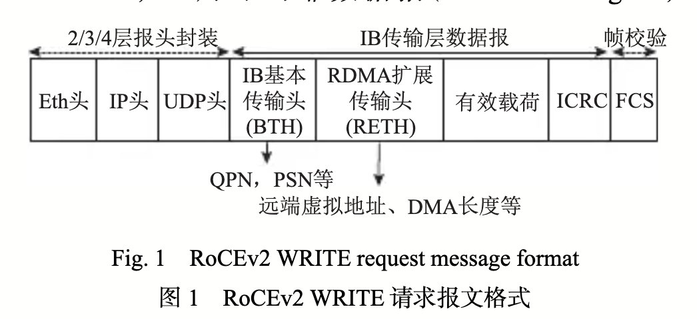
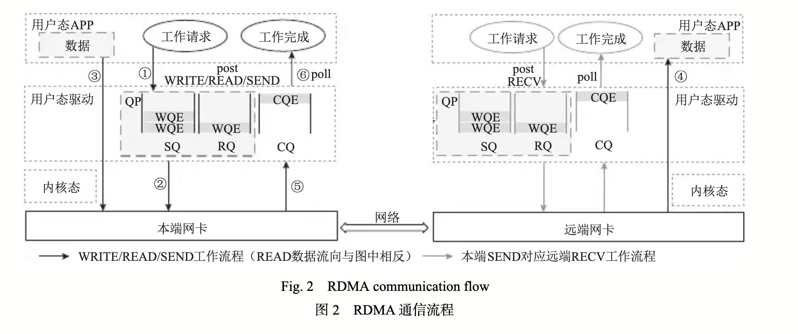
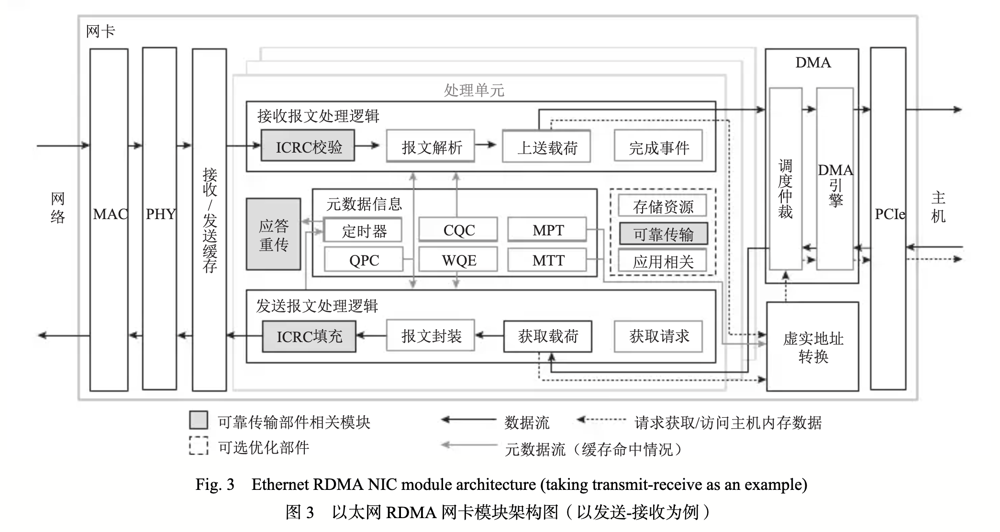

> [1]黄曼蒂,李韬,杨惠,等.以太网RDMA网卡综述[J].计算机研究与发展,2025,62(5):1262-1289.
> https://zhuanlan.zhihu.com/p/1982525738998588869


1. 背景：以太网的传输速率 突破400Gps，朝着800Gps，1.6Tps发展，cpu的处理速度无法跟上
2. 定义：== RDMA （remote direct memory access）采用零拷贝（zero copy），内核旁路（kernel bypass）和处理器功能卸载（cpu offload）等思想 ==，可以远程直接内存访问，不需要CPU参与的情况下直接读下远端内存，实现高带宽低延迟的数据传输
3. 实现方式：IB（InfiniBand），RoCE（RDMA over coveraged Ethernet）和 iWarp   --*本质是网络协议和架构*
  - IB 性能最好，但自定义了全链路层的整套规范，需要专用网卡和交换机支持，不兼容以太网且价格昂贵
  - ROCE v1 将 IB 的链路层替换为以太网协议，ROCE v2 在 v1 基础上进一步将网络层替换为UDP/IP协议，== 允许使用标准以太网交换机进行跨网路由，只需要额外增设一个专用网卡支持 ==
  - iWarp 同样兼容以太网，但需将整个TCP/IP协议栈卸载到硬件
  
== 在RDMA理念中，核心的两个抽象是HCA（host channel adapter，也就是网卡）和QP（队列对）。其中HCA指的是硬件，QP则是软件。HCA内部通过硬件独立处理网络协议栈，内存注册，数据包发送和接收。HCA可以通过PCIe总线连接到host或者device的内存，应用程序通过HCA暴露的内存映射寄存器（MMIO）控制HCA。==

== QP这个软件概念，一般是由两部分组成，SQ和RQ（send queue和receive queue）。通信之前，机器之间通过某些建联机制建立起QP，交换各自的QP信息，SQ和RQ的关系并非是想象那样从SQ出发的数据进入对方的RQ，这两个queue之间没有直接的数据交流，而是通过实际传输的网络包构建的逻辑关系。发送方对自己的SQ放入信息，告诉网卡要发送的数据在哪里，网卡把数据打包发出去。接收方则是把自己要接收的数据信息放在RQ告诉网卡，网卡会预留内存等待数据到达，这个就是双边通信。单边通信则是不需要接收方在RQ中放WR。==

== 应用程序和HCA之间沟通的结构称为WR（work request），而HCA实际操控硬件单元完成各种操作，需要的是更贴近硬件的数据结构，称为WQE（work queue entry）。==


	

# RDMA 传输流程

## RDMA 传输准备阶段

1. rdma 建立连接，rdma 允许本端用户态应用程序快速写远端内存。
> 对比
> - 无rdma
> a gpu → gpu memory → cudaMemcpy → host memory → TCP/IP stack → NIC → network → NIC → host memory → cudaMemcpy → remote gpu memory
> - 没有GPUDirect + rdma：
> gpu memory → cudaMemcpy → host pinned memory → RDMA NIC → 网络 → 远端 NIC → 远端 host memory
> - 有GPUDirect+rdma：
> gpu memory → NIC → 网络 → NIC → 远端 gpu memory

因此，在正式通信之前，rdma本端引用程序需要首先申请注册内存区域（memory region， MR）用于存放收发数据，并与通信远端进行建链协商，提前获取远端主机信息和内存访问权限等（需要cpu参与）

> iWARP 和 ROCE v1 基于 CM（communication manager）接口建联，ROCE v2 同时机遇 CM 接口和Socket接口2中建链方式
> ** CM 和 Socket 区别：**
> socket需要自己写数据传输和控制层，而CM 已经封装好
> 

2.RDMA通信原语，RDMA通过verbs 变成编程接口为上层应用提供两种通信原语，分别为双边通信原语和单边通信原语
- 双边通信原语 RECV 和 SEND ：需要远端CPU在本端SEND发送消息前提前下发RECV制定接受地址
- 单边通信原语 READ，WRITE，ATOMIC则不涉及远端CPU参与，可以获得更低的延迟和更高的带宽


> verbs 就是 RDMA 的标准底层编程接口（libibverbs），给应用程序一套原语，直接操控 RNIC（RDMA 网卡）硬件，绕开内核协议栈，实现远端内存直接读写。
> 此外，SEND 和 WRITE可以携带额外的4B的数据，改数据不直接写入内存，而是作为状态信息返回给上层应用（CPU参与）

## RDMA正式传输：
待链路成功建立后，随即进入 RDMA 数据传输工作流程：

1.应用程序通过RDMA以工作请求（work request，WR）的形式下发post远端访问请求，报文如[@fig:ROCEv2_write]所示
{#fig:ROCEv2_write}

2. 对于应用下发的 WR，由用户态驱动将其转化为工作队列元素 （work queue element，WQE）并放入队列对（queue pair，QP）中（[@fig:Rocev2_process] 中①）。
> QP 是 RDMA 双端通信的基本单位，由发送队列 （send queue，SQ）和接收队列（receive queue，RQ）组成，
> 具体来说：由 SQ 接收应用程序下发的 SEND，READ，WRITE 等请求，由 RQ 接收应用程序下发的 RECV（对应 SEND 请求）。 对于 RDMA WRITE 操作，由网卡在获取 RDMA 传输请（[@fig:Rocev2_process] 中②）后取出本端内存数据（[@fig:Rocev2_process] 中③）并执行远端内存写入（[@fig:Rocev2_process] 中④。


QP可以通过一下四种方式进行通信，包括

|类型 | 描述 | 消息大小 | 适用 |
| --- | --- | --- | --- |
|Reliable Connected（RC）| 可靠、有序、点对点 |	<= 2^21| 最常用
|Unreliable Connected（UC）| 不可靠、有序、会丢包 | <= 2^21|	
|Reliable Datagram（RD）	| 可靠、无序 | | multicast
|Unreliable Datagram（UD）| 不可靠、无序|<= 4 | 路由管理|

3. 数据完成传输后，网卡生成完成队列元素（completion queue element，CQE）并将之放入与 QP 关联的完成队（completion queue，CQ）中（[@fig:Rocev2_process] 中⑤），最终应用程序由网卡上送（poll）的工作完成 （work completion，WC）获知 RDMA 传输完成[@fig:Rocev2_process] 中⑥）。

{#fig:Rocev2_process}

# RDMA 网卡架构
包含一下7个部件，架构图如{@fig:rdma_arch}：
- 用于连接主机端的CPU和内存的PCIe部件
- 用于连接网络端的MAC部件和PHY部件
- 用于处理本端或远端不同通信原语对应的RDMA请求和响应，进行保温封装和解析的保温处理逻辑部件
- 用于直接访问主机内存的虚实地址转换，DMA部件
- 用于支持RC传输的可靠性传输部件
- 用于存储数据和元数据信息的网卡SRAM（static random access memory）缓存
- 不同网卡架构中还可能有其他可选部件，可以在存储资源，可靠传输，应用方面进行优化
{#fig:rdma_arch}

# RDMA和host/device的交互
RDMA虽然想要bypass CPU，但是不能完全不和CPU交互。和CPU交互主要有两个机制：== 反馈和内存注册 ==。反馈通过CQ（completion queue）完成。SQ/RQ上的WQE被完成了，HCA都会生成一个CQE（completion queue element）放在CQ中，用于记录哪个QP上的操作完成了。应用程序想要知道自己的通信是否完成，就要不断地poll CQ查看是否有新的CQE（CPU自旋在这个等待上）。HCA也支持中断事件，在CQ出现新的CQE的时候就去中断一下CPU（CPU之前可以异步作别的事情）。两种方法各有优缺点，polling方式浪费CPU，但是获取CQE延迟最小。中断方式解放CPU，但是获取CQE延迟大。

RDMA需要能访问host内存，内存注册（memory registration, MR）提供了安全的访问机制。注册通过HCA驱动完成，这块内存需要物理上被锁住（禁止换页），这块内存对应生成多个TPT（translation and protection table）条目，记录虚拟地址、物理地址、访问权限。注册后，会生成一个Memory Key返回给应用程序。Key有两个：LKey（local key）和RKey（remote key）,LKey是自己访问自己的内存，需要放在WR里的，RKey是远端访问本地内存需要提供的key。

对于device来说，也可以直接由HCA注册内存，这样通信就无需把数据从device内存搬运到host内存。比如NV提供的GPUDirect支持，就是一项允许HCA直接访问GPU内存的技术。

# RDMA编程基础

## 1. 创建资源
通信时，资源的创建必须按照顺序：

|顺序 | 资源名称 | 作用 | API/概念 |
| --- | --- | --- | --- |
1 | 上下文 (Context)	| 表示 HCA 本身，是所有操作的锚点。| ibv_context (通过 ibv_open_device 获取) |
2 | 保护域 (PD) | 内存安全沙箱，所有内存和队列资源必须绑定到 PD。| ibv_alloc_pd |
3 | 完成队列 (CQ) | HCA 用来报告事件的队列 | ibv_create_cq |
4 | 内存区域 (MR) | 注册 GPU 或主机内存，实现零拷贝。	| ibv_reg_mr |
5 | 队列对 (QP) | 双向通信通道 (SQ + RQ)。| ibv_create_qp |


#include <stdio.h>
#include <stdlib.h>
#include <unistd.h>
#include <infiniband/verbs.h> //rdma的verbs api库（ibv_**）

// 宏定义：队列大小
#define CQ_SIZE 10 // 完成队列深度
#define QP_SIZE 10 // 队列对深度 (SQ + RQ)

// 结构体：存储本地 RDMA 资源
struct RDMA_Resources {
    struct ibv_context *context; // HCA/RNIC 上下文
    struct ibv_pd *pd;           // 保护域
    struct ibv_cq *cq;           // 完成队列
    struct ibv_qp *qp;           // 队列对
    struct ibv_mr *mr;           // 内存区域 (Memory Region) 句柄
    char *buffer;                // 指向 Host 内存缓冲区的指针
    size_t buf_size;             // 缓冲区大小
};

// 全局资源对象
struct RDMA_Resources res;

#define BUF_SIZE 1024 // 缓冲区大小 1KB

int reg_memory() {
    // 1. 分配 Host 内存
    res.buf_size = BUF_SIZE;
    // 使用 aligned_alloc 以确保内存对齐，尽管 RDMA 不强制要求，但这是一个好的实践
    if (posix_memalign((void **)&res.buffer, sysconf(_SC_PAGESIZE), res.buf_size)) {
        fprintf(stderr, "错误: 无法分配对齐的主机内存。\n");
        return 1;
    }

    // 简单填充缓冲区，便于验证
    snprintf(res.buffer, res.buf_size, "Hello, RDMA World! Data from Host.");
    printf("✅ 主机缓冲区分配成功，大小: %zu 字节。\n", res.buf_size);

    // 2. 注册内存区域 (MR)
    // ibv_reg_mr(pd, addr, length, access_flags)
    // IBV_ACCESS_LOCAL_WRITE: 允许 HCA DMA 写入本地内存 (用于接收)
    // IBV_ACCESS_REMOTE_WRITE: 允许远程机器 RDMA 写入此内存
    // IBV_ACCESS_REMOTE_READ: 允许远程机器 RDMA 读取此内存
    int access_flags = IBV_ACCESS_LOCAL_WRITE |
                       IBV_ACCESS_REMOTE_WRITE |
                       IBV_ACCESS_REMOTE_READ;

    res.mr = ibv_reg_mr(res.pd, res.buffer, res.buf_size, access_flags);
    if (!res.mr) {
        fprintf(stderr, "错误: 无法注册内存区域 (MR)。\n");
        // 注册失败，需要释放已分配的内存
        free(res.buffer);
        return 1;
    }

    printf("✅ 内存区域注册成功。\n");
    printf("   LKey (本地键): 0x%x\n", res.mr->lkey);
    printf("   RKey (远程键): 0x%x\n", res.mr->rkey);
    printf("   Buffer: %s\n", res.buffer);
    
    return 0;
}

int init_resources(const char *dev_name) {
    struct ibv_device *ib_dev = NULL;//指向单个设备的指针
    struct ibv_device **dev_list = NULL;//指向这个数组的指针
//总而言之，用一个指针指向设备，然后将指针存储为一个list，然后再用一个指针完成遍历；多一个星号可以多一次寻址

    int num_devices = 0;
    int i;

    // 1. 获取 HCA 设备列表
    dev_list = ibv_get_device_list(&num_devices);
    if (!dev_list || num_devices <= 0) {
        fprintf(stderr, "错误: 未找到任何 InfiniBand/RDMA 设备。\n");
        return 1; // return 0 视为正常执行；return 非0 报错
    }

    // 查找指定设备 (如果 dev_name 为 NULL, 默认使用第一个)
    if (dev_name) {
        for (i = 0; i < num_devices; ++i) {
            if (!strcmp(ibv_get_device_name(dev_list[i]), dev_name)) {
                ib_dev = dev_list[i];
                break;
            }
        }
    } else {
        ib_dev = dev_list[0];
    }

    if (!ib_dev) {
        fprintf(stderr, "错误: 未找到设备 %s\n", dev_name ? dev_name : "第一个设备");
        ibv_free_device_list(dev_list);
        return 1;
    }

    // 2. 打开 HCA 设备并创建上下文 (Context)
    res.context = ibv_open_device(ib_dev);
    ibv_free_device_list(dev_list); // 列表已不再需要
    if (!res.context) {
        fprintf(stderr, "错误: 无法打开设备上下文。\n");
        return 1;
    }

    // 3. 分配保护域 (PD)
    res.pd = ibv_alloc_pd(res.context);
    if (!res.pd) {
        fprintf(stderr, "错误: 无法分配保护域。\n");
        return 1;
    }

    // 4. 创建完成队列 (CQ)
    // ibv_create_cq(context, cqe, cq_context, channel, comp_vector)
    // cqe: 完成队列深度，必须大于 (SQ_SIZE + RQ_SIZE)
    res.cq = ibv_create_cq(res.context, CQ_SIZE, NULL, NULL, 0);
    if (!res.cq) {
        fprintf(stderr, "错误: 无法创建完成队列。\n");
        return 1;
    }

    // 5. 创建队列对 (QP)
    struct ibv_qp_init_attr qp_init_attr = {
        .qp_context = NULL,
        .send_cq = res.cq, // 发送和接收都使用同一个 CQ
        .recv_cq = res.cq,
        .cap = {
            .max_send_wr  = QP_SIZE, // SQ 深度
            .max_recv_wr  = QP_SIZE, // RQ 深度
            .max_send_sge = 1,       // 每次操作的最大 Scatter/Gather 元素数
            .max_recv_sge = 1
        },
        .qp_type = IBV_QPT_RC // 使用 Reliable Connected (RC) 类型
    };

    res.qp = ibv_create_qp(res.pd, &qp_init_attr);
    if (!res.qp) {
        fprintf(stderr, "错误: 无法创建队列对 (QP)。\n");
        return 1;
    }

    printf("✅ 资源初始化成功: Context, PD, CQ, QP 已创建。\n");

    reg_memory();
    return 0;
}

void destroy_resources() {
    // 1. 销毁 MR 和释放缓冲区
    if (res.mr) {
        ibv_dereg_mr(res.mr);
        printf("🧹 MR 已注销。\n");
    }
    if (res.buffer) {
        free(res.buffer);
        printf("🧹 Host 缓冲区已释放。\n");
    }
    if (res.qp) ibv_destroy_qp(res.qp);
    if (res.cq) ibv_destroy_cq(res.cq);
    if (res.pd) ibv_dealloc_pd(res.pd);
    if (res.context) ibv_close_device(res.context);
    printf("🧹 所有 RDMA 资源已清理。\n");
}


int main(int argc, char *argv[]) {
    // 您可以通过命令行参数指定 HCA 设备名称，例如 mlx5_0
    const char *device_name = (argc > 1) ? argv[1] : NULL;

    if (init_resources(device_name)) {
        fprintf(stderr, "🔴 初始化失败，程序退出。\n");
        return 1;
    }
    
    // 可以在这里插入 QP 状态转换和通信代码 (后续单元将实现)
    printf("QP 号码 (QPN): 0x%x\n", res.qp->qp_num);

    destroy_resources();
    return 0;
}
```


## 2.建立通信


# RDMA 网卡优化
分为三大类：
1. 存储资源优化
> rdma 硬件卸载和内核旁路等特性要求在网卡中缓存QPC，MTT等元数据信息以维护QP连接状态和进行直接内存访问等。

2. 可靠性优化
   - 拥塞优化：基于ECN，RTT，INT
   - 流量控制
   - 重传控制
3. 应用相关优化
   - 分布式存储：存储类型，存储应用
   - 数据中心应用：性能隔离，通用优化

# 网卡评估
指标：带宽，延迟，每秒消息数（messages per second， MPS），cpu利用率
- 运行一组代表性应用程序工作负载
- 使用专业性能评估工具，perftest
